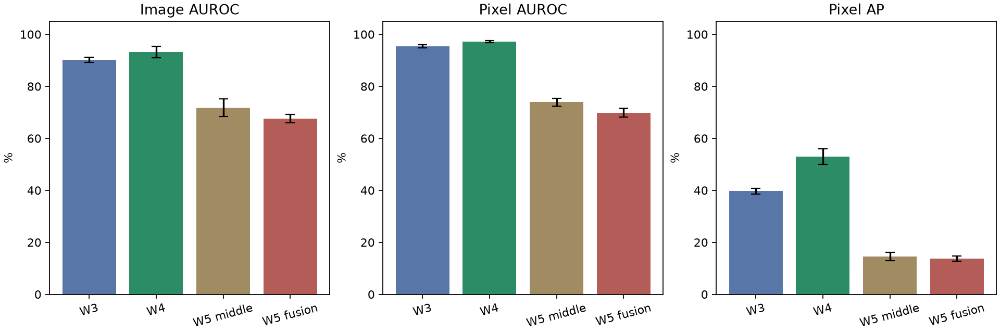

# Comparing Weeks 3, 4 and 5

[All weeks](../README.md) | [Same-image gallery](HEATMAPS.md) | [Every run](per_run.csv)

Week 4 remains our strongest tested configuration. Week 5 answered a narrower question about combining compressed feature levels, and did not produce an overall improvement. The comparison below explains what is supported, what remains uncertain and what belongs in the midterm.

## The sequence of questions

1. **Week 3:** can we establish a repeatable FastFlow baseline on the full dataset? We used ResNet-18, ran every category and repeated three seeds.
2. **Week 4:** does the larger reference configuration improve detection and localization? We switched to WideResNet and its associated weights and flow convolution pattern.
3. **Week 5:** at a fixed small input budget, does combining fine, middle and coarse features before one flow help compared with middle features alone? We ran a matched pair rather than comparing fusion only against a much larger original model.

This sequence follows the proposal from baseline to backbone comparison to feature fusion. It does not mean each week must score higher than the previous one. The fusion hypothesis was plausible, but its full result was negative overall.

## What the measurements mean

Image AUROC measures ranking of defective images against normal images. Pixel AUROC measures ranking of defective pixels against normal pixels. Pixel AP summarizes precision and recall for defective pixels and helps reveal false responses when defects are small. None of these is a thresholded accuracy percentage, and a heatmap is not a calibrated probability of a defect.

For each seed, we average the category metrics equally across all 15 categories. The table gives the mean and sample standard deviation of those three averages. Pixel metrics are calculated over all test pixels within each category before category averaging. Pixels are not independent experimental replicates, and the three seeds are repeats on the same test images.

| Configuration | Image AUROC | Pixel AUROC | Pixel AP |
| --- | ---: | ---: | ---: |
| Week 3: ResNet-18 | 90.17 ± 0.99% | 95.41 ± 0.59% | 39.69 ± 1.04% |
| Week 4: WideResNet-50-2 | 93.17 ± 2.14% | 97.19 ± 0.49% | 52.99 ± 2.95% |
| Week 5: middle-only control | 71.76 ± 3.39% | 73.89 ± 1.41% | 14.57 ± 1.68% |
| Week 5: fusion | 67.55 ± 1.66% | 69.80 ± 1.68% | 13.79 ± 1.04% |

Week 4 improves over Week 3 by 3.00 image AUROC points, 1.78 pixel AUROC points and 13.29 pixel AP points. This is a useful configuration comparison, but not a causal estimate of backbone size alone: pretrained weights and flow convolution patterns changed too.

Both Week 5 variants perform much worse than Week 4. Since both replace the original representation and three separate flows with a compressed representation and one small flow, we cannot attribute that entire drop to fusion. Their paired difference is the appropriate primary comparison for the Week 5 question.

## Did fusion help?

On the complete 15-category comparison, no overall benefit was established. Fusion changed image AUROC by -4.21 points, pixel AUROC by -4.09 points and the predeclared primary metric, pixel AP, by -0.78 points.

The paired seed changes in image AUROC are -5.85, -4.53 and -2.26 points. Pixel AUROC also falls for all three seed averages. Pixel AP changes by -3.20, +1.19 and -0.32 points, so its small overall decline is less consistent across seeds. We should not turn that into a strong statistical claim of universal inferiority.

Six categories improve in mean pixel AP, each with all three paired seeds improving. Nine decline. The median category change is -1.64 AP points, so the typical category does not show a gain. These descriptive comparisons are more informative than treating the thousands of correlated pixels as independent samples in a significance test.

### A useful distinction: textures versus objects

| Categories | Image AUROC change | Pixel AUROC change | Pixel AP change |
| --- | ---: | ---: | ---: |
| Five textures | -12.64 points | -10.82 points | -6.94 points |
| Ten objects | +0.00 points | -0.73 points | +2.30 points |

The textures are carpet, grid, leather, tile and wood. Every texture category loses mean pixel AP, and each loses AP in all three paired seeds. Object categories have a positive AP average but essentially unchanged image AUROC. This distinction was examined after seeing the results, so it is a hypothesis-generating subgroup analysis, not a new primary success criterion.

A possible explanation is that compression and joint modeling disturb dense texture information differently from object structure. The subgroup pattern does not prove that explanation. Objects also contain fine textures, and several object categories fail badly. A useful follow-up would hold the representation and optimization choices fixed while testing this mechanism explicitly.

### Is one category deciding the conclusion?

Removing each category in turn leaves the image AUROC change between -5.34 and -2.61 points and pixel AUROC between -5.47 and -2.88 points. Their negative overall direction is not caused by one category alone.

Pixel AP is more sensitive. Its leave-one-category-out change ranges from -1.36 to +0.06 points. Removing wood makes it slightly positive. We retain wood and the full primary result, but this sensitivity limits how strongly we should characterize the small aggregate AP loss. See [all sensitivity results](sensitivity.csv) and [paired changes](paired_changes.csv).

## What the same images show across weeks

The [gallery](HEATMAPS.md) has 36 matched comparisons across all four configurations and all three seeds. For each category, the first normal and first defective image in filename order are included. Six examples already used in the Week 5 discussion are added. This avoids constructing the entire comparison from the largest wins or losses, although the selection is still not a representative sample.

Each map is scaled separately for display, and the cyan cross marks its maximum. Compare response location, the mask and the printed per-image AP. Do not interpret brighter colors in one model as higher calibrated confidence than another model. Per-image AP averages below are not the same metric aggregation as the category-wide AP table.

| Selected defect | Week 3 AP | Week 4 AP | W5 middle AP | W5 fusion AP |
| --- | ---: | ---: | ---: | ---: |
| bottle, contamination/005 | 91.84% | 93.78% | 18.28% | 74.19% |
| carpet, hole/004 | 92.11% | 66.78% | 34.04% | 3.89% |
| hazelnut, hole/007 | 88.36% | 69.99% | 39.10% | 3.28% |
| pill, contamination/018 | 74.21% | 71.54% | 2.34% | 72.29% |
| screw, scratch_head/010 | 2.93% | 14.78% | 18.68% | 1.27% |
| wood, hole/008 | 54.28% | 73.82% | 48.45% | 9.08% |

The bottle contamination example makes the main distinction clear. Fusion is much better than its compact control, but still worse than the earlier FastFlow models on that image. Calling it a fusion success without showing the original models would leave out important context.

The hazelnut hole was localized well by the earlier configurations. In the compact models, the signal becomes weaker and less consistent, especially with fusion. This supports investigating what was lost during the representation change. It does not isolate which change caused the loss.

Carpet shows a similar loss of useful localization, with strong irrelevant responses in some runs. Screw remains difficult and varies by seed. Even the compact middle-only model can improve a particular screw image while performing poorly on the category overall. This is why selected heatmaps support interpretation rather than replace the complete results.

## Does late training explain the result?

We replayed epochs 400, 450, 475 and 500 for bottle, carpet, hazelnut and screw, using both Week 5 variants and all three seeds. All 24 final-checkpoint predictions matched the saved maps exactly. This is a stronger check than recomputing metrics from saved maps alone.

Hazelnut and screw were already weak at epoch 400 and remained weak at the other retained checkpoints. Their failure is therefore not just an unlucky epoch-500 snapshot. Carpet fluctuates substantially, so stability remains a concrete concern there. Bottle's middle-only localization declines over the late checkpoints while fusion stays roughly level on average.

We do not have the corresponding earlier Week 5 checkpoints to locate when those weaknesses first developed. Nor does this prove the underlying cause. See the [checkpoint analysis](../week5/checkpoints/README.md), which reports every retained checkpoint and keeps epoch 500 as the published endpoint.

## The remaining baseline gap

The FastFlow paper's matching ResNet-18 reference is 97.9% image AUROC and 97.2% pixel AUROC. Its WideResNet reference is 99.3% and 98.1%. Our baseline gaps are therefore:

| Configuration | Image gap below reference | Pixel gap below reference |
| --- | ---: | ---: |
| Week 3 | 7.73 points | 1.79 points |
| Week 4 | 6.13 points | 0.91 points |

These compare against the backbone-specific references, not the paper's headline result from a different backbone. The [FastFlow paper](https://arxiv.org/abs/2111.07677) supplies the reference values. Our Anomalib training pipeline is not an exact copy of the authors' pipeline, and it does not use augmentation. The paper's own augmentation ablation does not establish that augmentation alone would close our much larger image gap. That needs a controlled test.

The reported 1 to 2 point midterm requirement was not found in the course guide we inspected. It may be in separate midterm instructions. Confirm its wording, metric and reference with the team. We cannot claim that image detection is within that range.

## What the scoring experiment adds

Our baseline uses the maximum pixel as the image score. That can be controlled by an isolated false response. Averaging a small set of high-scoring pixels tests whether the strongest evidence is supported over more than one location, without averaging away a small defect across the whole image.

Across all 45 Week 4 runs, averaging the highest 1% raises image AUROC from 93.17% to 96.34%, with all category means improving. The maps and pixel metrics are unchanged. We also report the maximum, highest 0.1%, whole-map mean and a local-average alternative in the [scoring analysis](../week4/image_score_check.md).

This supports sensitivity to image-score aggregation, not proof that the background is the sole cause or that exactly 1% is optimal. It is an exploratory test-set finding and remains 2.96 points below the paper reference. It should be a separate analysis in the midterm, not silently substituted into the main baseline table or mixed into the Week 5 protocol.

## What the checks do and do not establish

The weekly audits recalculated saved metrics, checked masks and labels, and checked recovery behavior. The cross-week export additionally checked image order, finite maps and maximum image scores across all 180 runs. It verified the saved map, score and metric receipts for Weeks 4 and 5 and recorded source hashes for the comparison inputs. The Week 5 checkpoint diagnosis independently replayed 24 final models.

Those checks make several simple explanations less likely, such as a broken saved-map export or inconsistent scoring in the reported runs. They do not rule out every upstream implementation issue or establish faithful reproduction of the paper. Fixed final-epoch evaluation avoids best-test-epoch selection, but does not guarantee that epoch 500 is a good operating point for every architecture.

All models use the same resized evaluation masks. Tiny defects can be affected by resizing. AP depends on defect prevalence, so it should be interpreted alongside the category and size breakdowns. No thresholded deployment operating point or independent domain-transfer result has been established.

The test set informed our exploratory inspection and the direction of later experiments. We did not train with its masks, but repeated inspection still limits claims of independent confirmation. Three seeds do not fix that issue. A publication claim would need a fixed protocol, stronger controls, comparison with relevant methods and confirmation beyond this repeatedly inspected benchmark.

## Cost and practical implications

Using each run's median recorded epoch time after the first epoch, then multiplying by 500, gives about 80.7 hours for the 45 Week 4 runs and 26.5 hours for the 90 Week 5 runs. The [timing summary](timing.json) records the calculation and source-history hashes. These are descriptive timing estimates from the completed logs, not wall-clock totals or a controlled speed benchmark. They exclude setup and evaluation, and median timing reduces the effect of long pauses. Hardware load and batching differed. The original Week 5 pilot predicted about 28 hours including modeled overhead.

The compact model makes a small follow-up practical, but cheaper training did not buy acceptable accuracy here. We should describe this as an unsuccessful accuracy-cost tradeoff so far, rather than an efficient improvement. Another full 90-run study still needs planning.

## What to put in the midterm

The report can explain the method and dataset, show the two baseline configurations, give the controlled fusion question, present all results including failures, and use matched images to explain the numbers. The negative result is useful because the experiment distinguishes a plausible idea from a supported improvement.

A suitable conclusion is:

> The WideResNet FastFlow configuration improved our overall results over ResNet-18, but an image-level gap from the published reference remains. Our compact feature-fusion model did not improve the full-dataset comparison against its matched middle-level control. Texture categories consistently lost localization performance, while some object categories improved. Both compact models were much weaker than the original FastFlow configuration. Retained checkpoints show that several weaknesses were already present before the final epoch. Further work should separate representation compression, spatial alignment and training behavior before treating this design as an improvement or extending it to another domain.

We have not completed EfficientNet-B4 or BatterySurAD transfer, and we should not present either as done. The team still needs to assemble the midterm document, literature discussion and requirement check from this material.

## What is worth trying next

First agree on the baseline requirement and whether the immediate priority is reproduction or revising the fusion design. Both are reasonable, but they answer different questions.

For the baseline gap, a controlled augmentation or scoring experiment is more relevant than further fusion changes. State the category-specific augmentation rules and evaluation protocol before running. Keep any scoring choice separate from already inspected test results.

For fusion, start with a small representation experiment, not another full sweep. The middle-only control is weak enough that it needs attention first. Test one factor such as projection width, normalization or spatial alignment, with an appropriate control. The LayerNorm parameter count changes with grid size, so a resolution experiment must report that too. Add a stronger single-level reference before making a broad claim about the value of multiple levels.

The texture/object pattern is a useful hypothesis to investigate. It is not justification for removing textures from the main benchmark. A published design such as [MSFlow](https://arxiv.org/abs/2308.15300) is a legitimate alternative, but reproducing it would be a separate experiment rather than calling our current implementation MSFlow.

The team can revise the Week 5 approach. Keep the existing results as the first experiment, write down what the revised design changes and why, then pilot it before a full run. See [running and changing experiments](../../docs/RUNNING.md).

## Supporting files

- [All weekly explanations](../README.md)
- [Full category table](per_category.csv), [all runs](per_run.csv), [paired Week 5 changes](paired_changes.csv) and [sensitivity checks](sensitivity.csv)
- [Same-image gallery](HEATMAPS.md), [selection rules](selected_images.csv) and [per-image measurements](selected_image_metrics.csv)
- [Saved-file hashes](source_files.csv) and [summary](summary.json)
- [Week 5 layer choice and alternatives](../week5/week5.md#why-these-layers-and-this-structure)
- [Checkpoint trajectories](../week5/checkpoints/README.md)

The figures are derived from the actual saved runs. Example images are from MVTec AD under [CC BY-NC-SA 4.0](https://www.mvtec.com/research-teaching/datasets/mvtec-ad).
