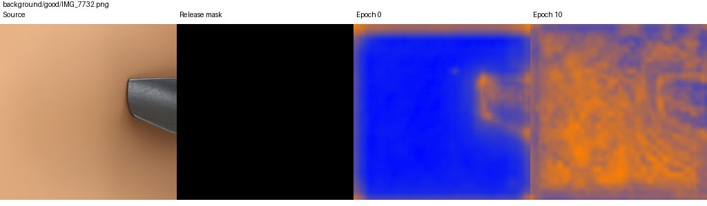
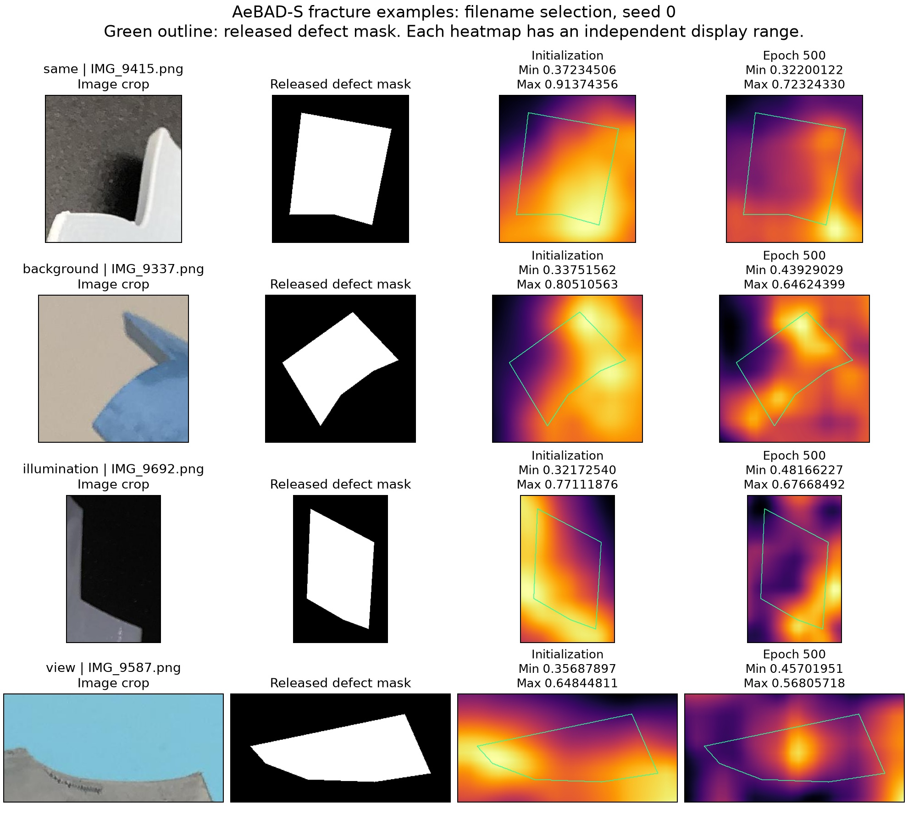
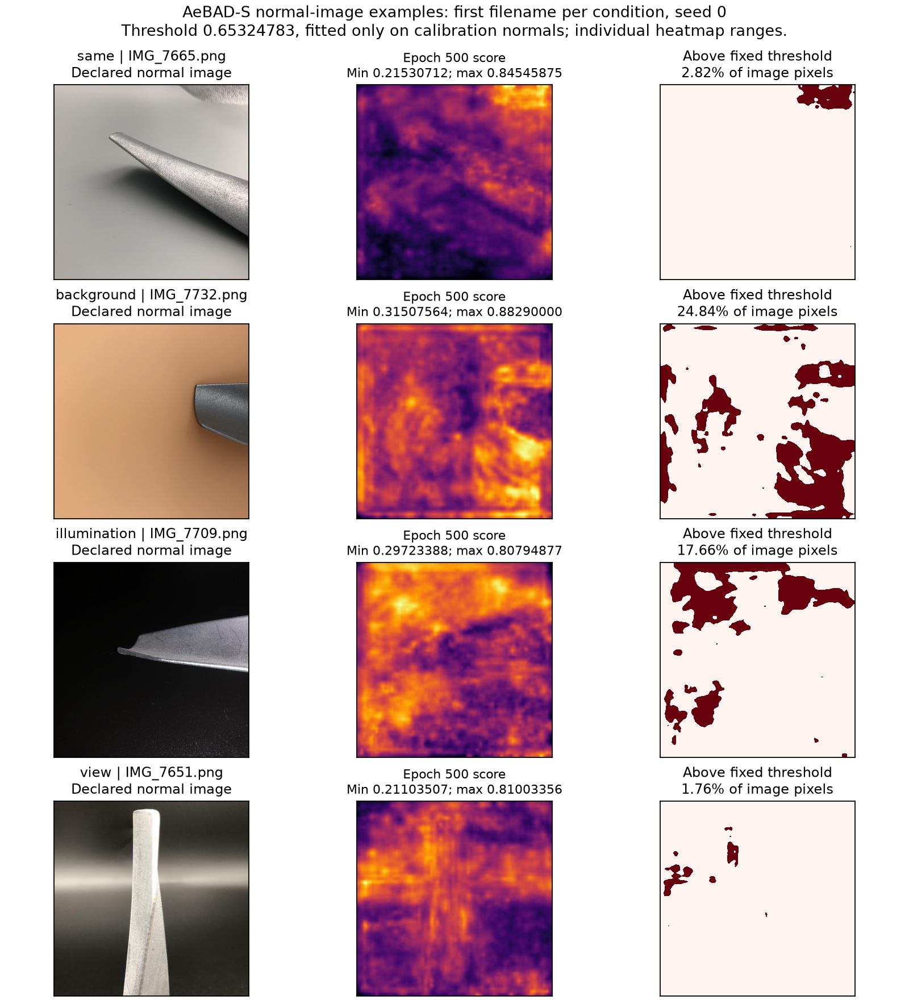

# AeBAD heatmaps

These figures show normal and fractured blades from the AeBAD development sample. Each heatmap uses its own color range, so brightness cannot be compared across panels. The HTML gallery and method notes include the selection and scoring details.

AeBAD-S, Zhang et al., CC BY 4.0.

## aebad-background-normal

## aebad-fracture-seed0

## aebad-normal-seed0

