# Matched recipe heatmaps

Seed 0; first normal and anomalous declared test image per category, chosen by filename before reading scores. Each sheet shows the same input and released mask with original ResNet, matched ResNet and WideResNet at epoch 500. Each heatmap has its own display range; compare localization, not color intensity across models.

MVTec AD, Bergmann et al. Derived visualizations under CC BY-NC-SA 4.0. All 30 selected examples are retained.

## bottle/test/good/000.png

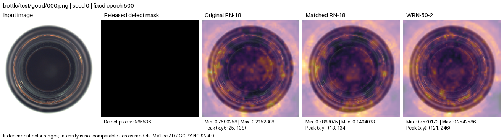

## bottle/test/broken_large/000.png

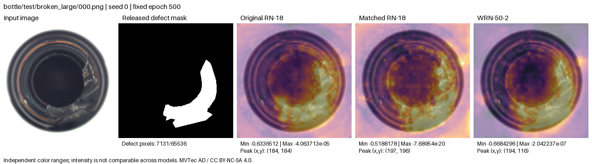

## cable/test/good/000.png

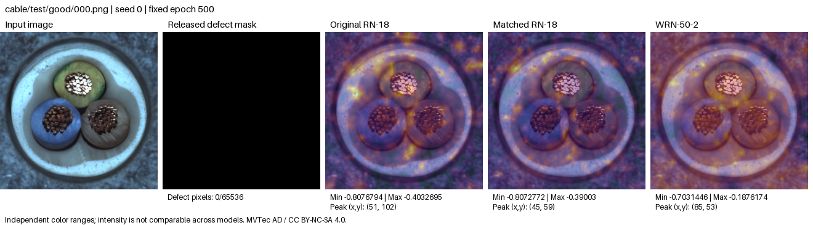

## cable/test/bent_wire/000.png

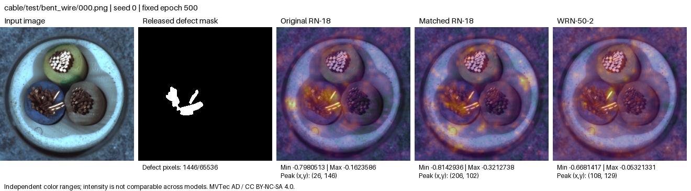

## capsule/test/good/000.png

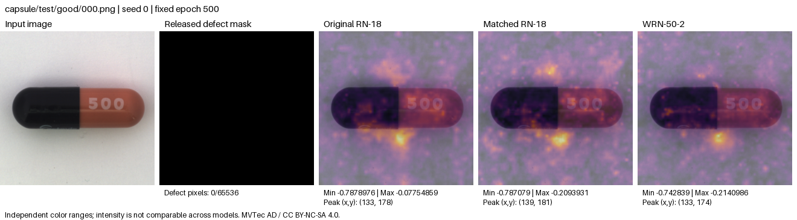

## capsule/test/crack/000.png

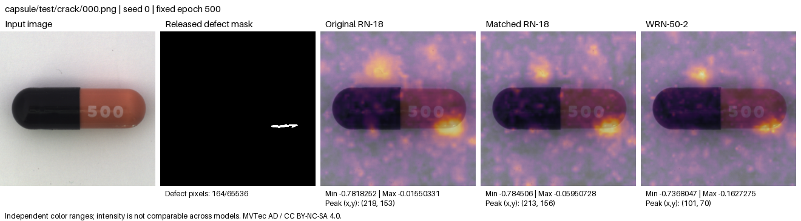

## carpet/test/good/000.png

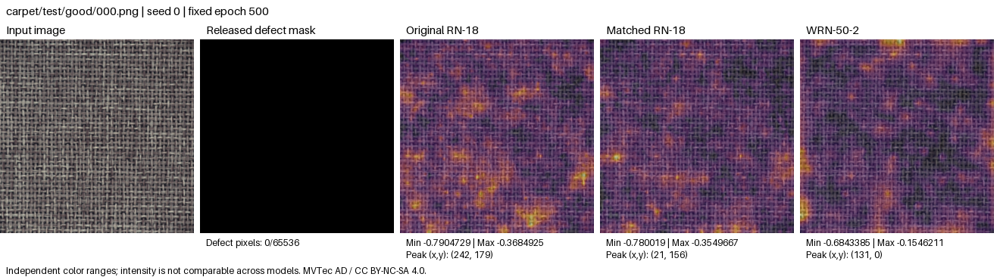

## carpet/test/color/000.png

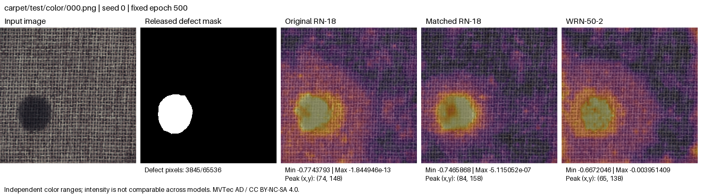

## grid/test/good/000.png

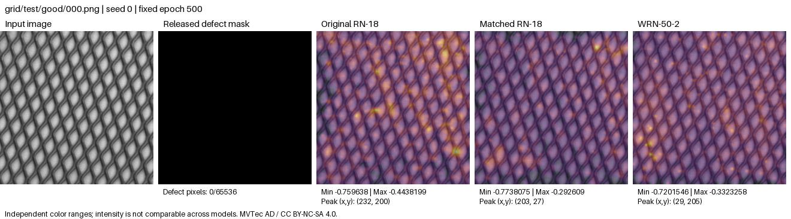

## grid/test/bent/000.png

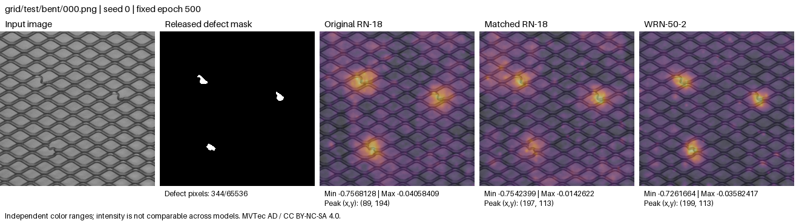

## hazelnut/test/good/000.png

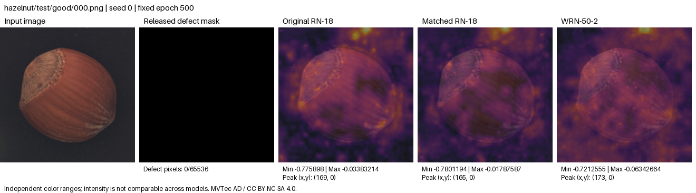

## hazelnut/test/crack/000.png

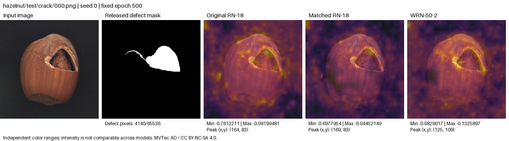

## leather/test/good/000.png

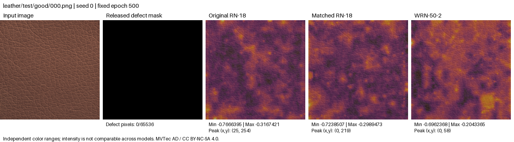

## leather/test/color/000.png

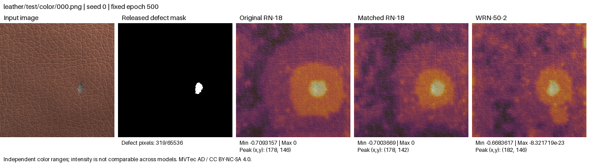

## metal_nut/test/good/000.png

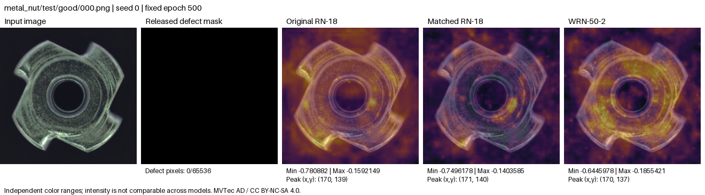

## metal_nut/test/bent/000.png

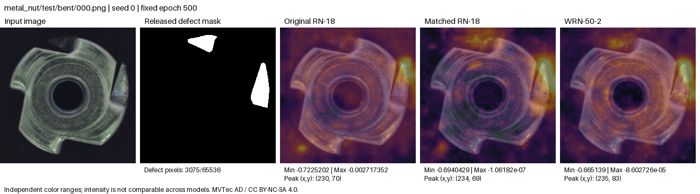

## pill/test/good/000.png

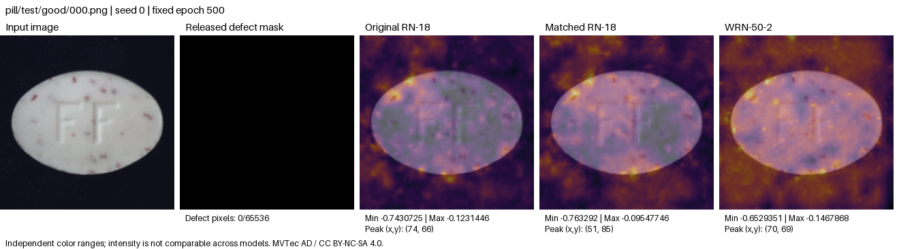

## pill/test/color/000.png

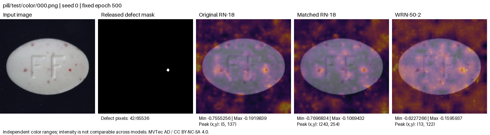

## screw/test/good/000.png

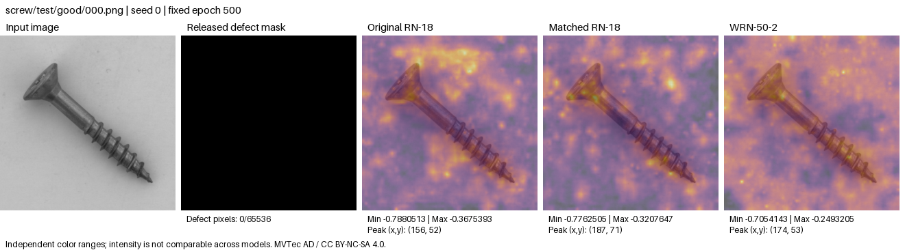

## screw/test/manipulated_front/000.png

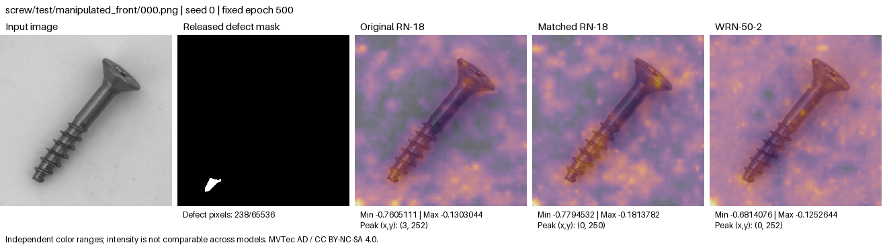

## tile/test/good/000.png

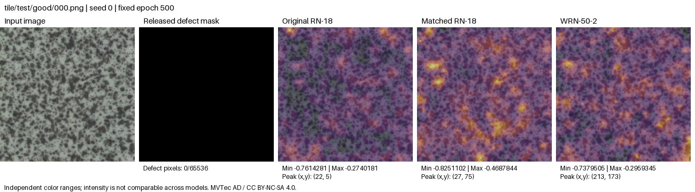

## tile/test/crack/000.png

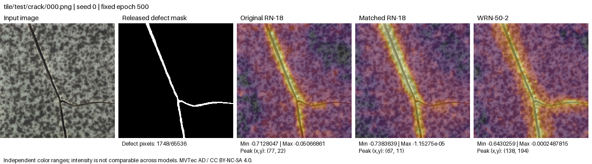

## toothbrush/test/good/000.png

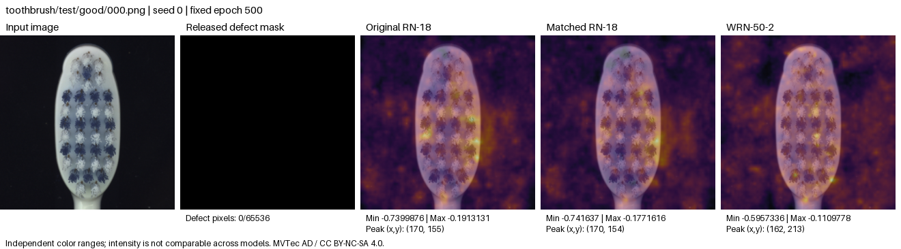

## toothbrush/test/defective/000.png

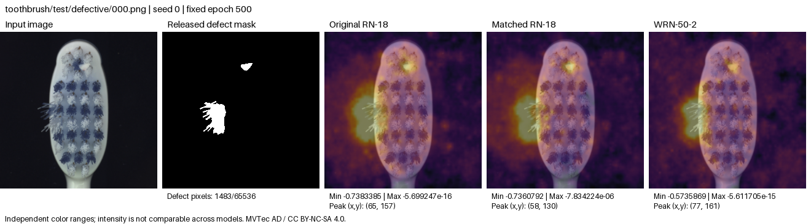

## transistor/test/good/000.png

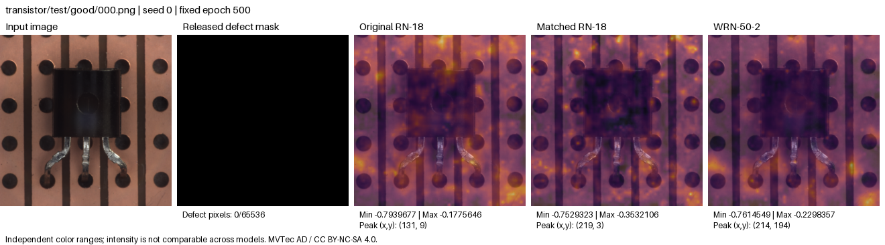

## transistor/test/bent_lead/000.png

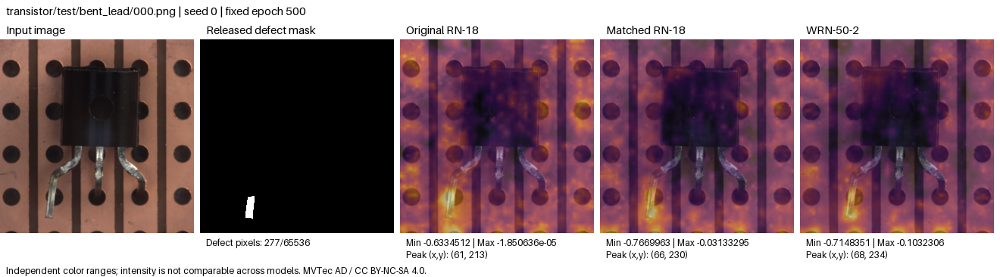

## wood/test/good/000.png

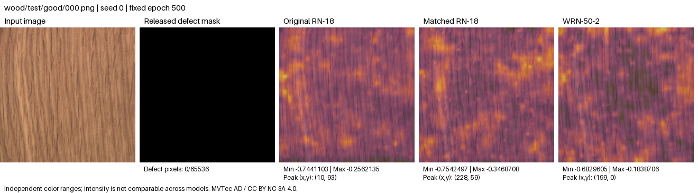

## wood/test/color/000.png

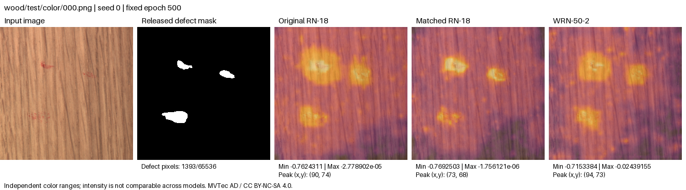

## zipper/test/good/000.png

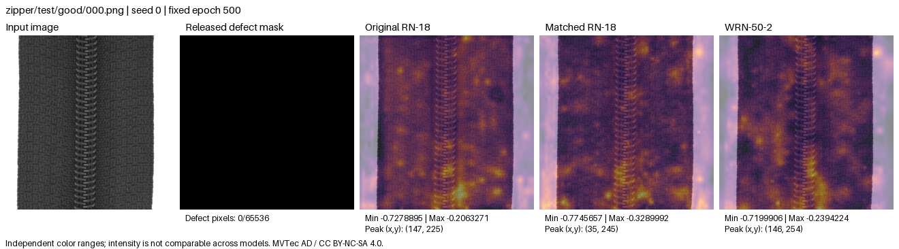

## zipper/test/broken_teeth/000.png

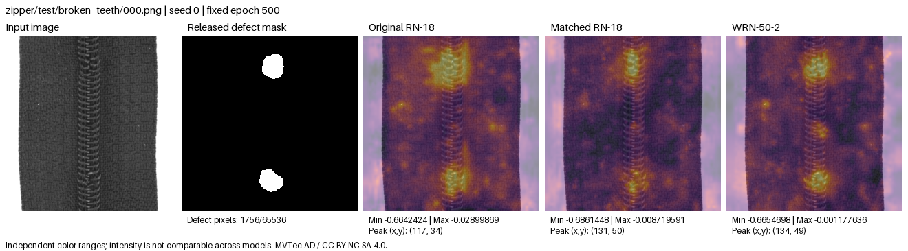
