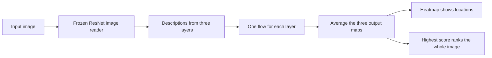
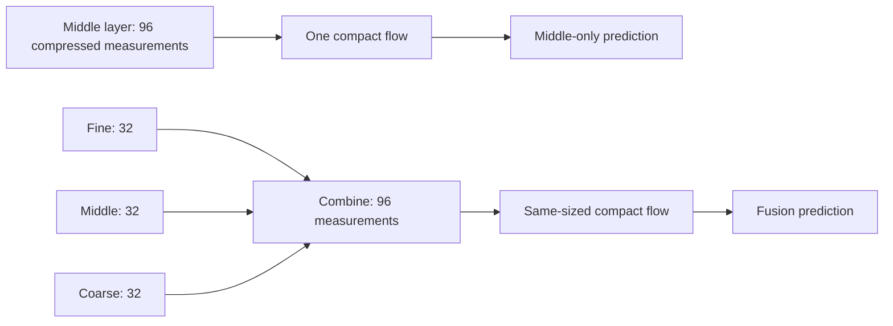
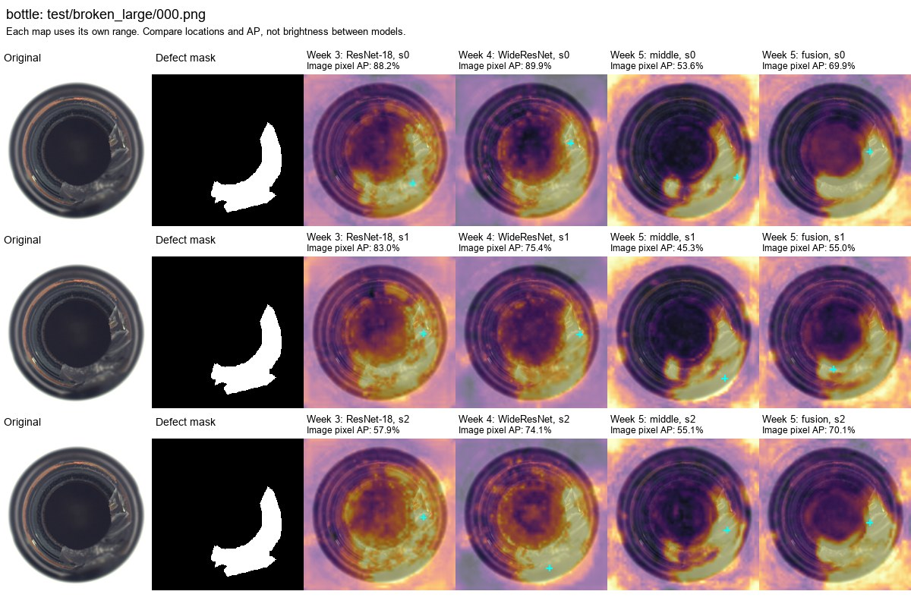
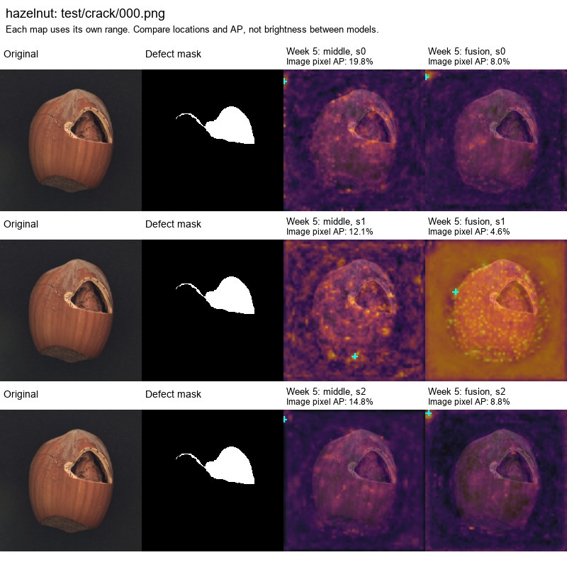
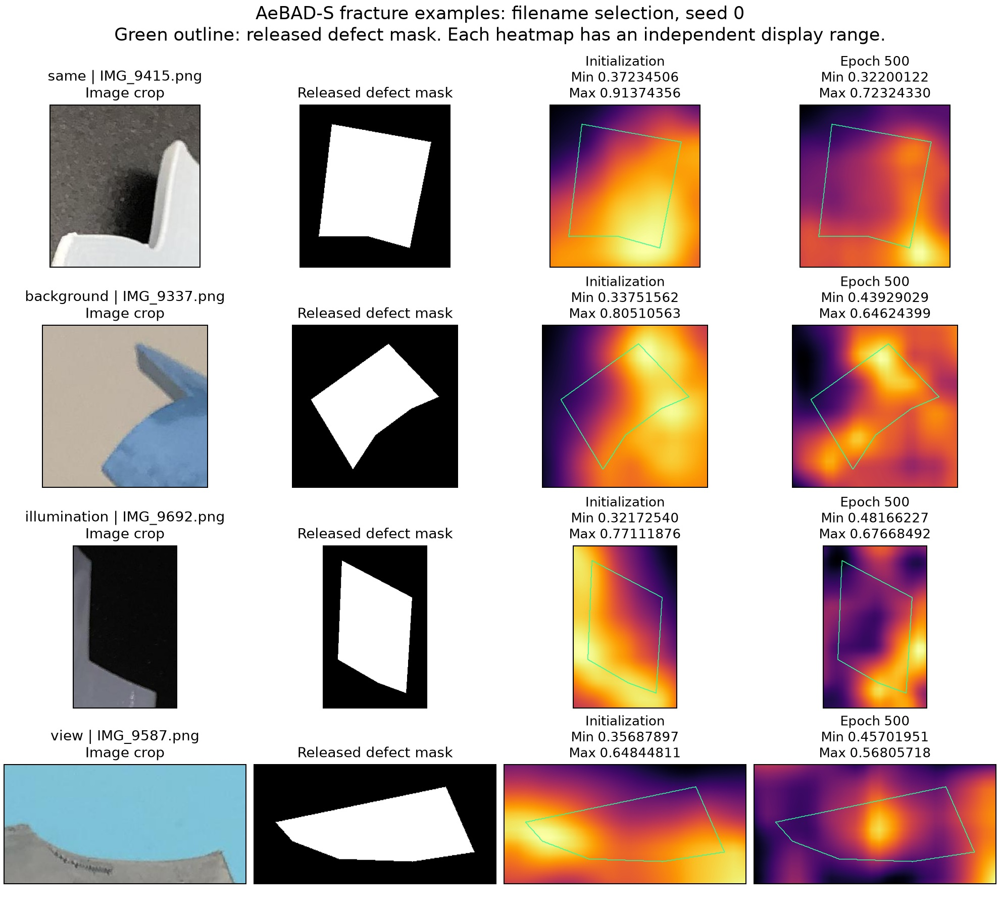
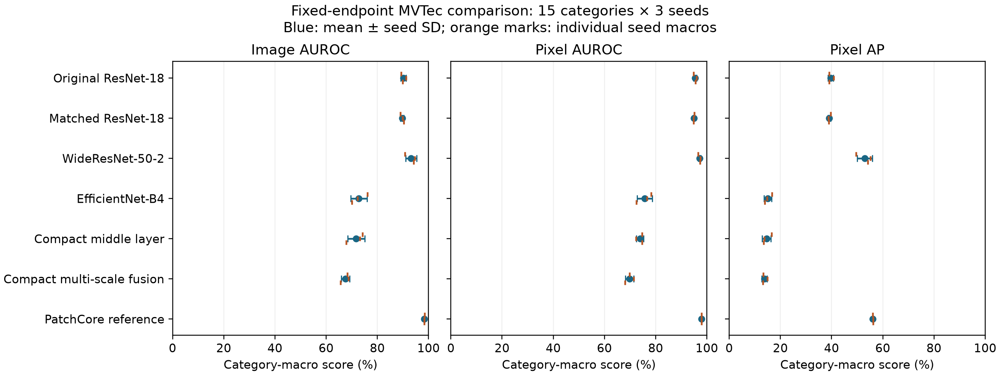

# The project from Week 1 to Week 10

We compared FastFlow on all 15 MVTec AD categories using the three backbones required by the assignment. We also built a compact multi-scale version, compared it with PatchCore, and tested FastFlow on aircraft-engine blade images. The compact version did not improve the average result, and the blade experiment produced substantial localization errors.

The sections follow the course schedule. EfficientNet, PatchCore, the extra ResNet control and the full blade study were completed later than planned.

- [Week 1: understand the task and choose a method](#week-1-understand-the-task-and-choose-a-method)
- [Week 2: prepare the data and experiment setup](#week-2-prepare-the-data-and-experiment-setup)
- [Week 3: establish the FastFlow baseline](#week-3-establish-the-fastflow-baseline)
- [Week 4: compare the image-reading networks](#week-4-compare-the-image-reading-networks)
- [Week 5: build our compact multi-scale model](#week-5-build-our-compact-multi-scale-model)
- [Week 6: evaluate the change and inspect the heatmaps](#week-6-evaluate-the-change-and-inspect-the-heatmaps)
- [Week 7: try a different industrial dataset](#week-7-try-a-different-industrial-dataset)
- [Week 8: compare all methods and investigate failures](#week-8-compare-all-methods-and-investigate-failures)
- [Week 9: turn the experiments into a report](#week-9-turn-the-experiments-into-a-report)
- [Week 10: review and submit](#week-10-review-and-submit)
- [Where the DINO tests fit](#where-the-dino-tests-fit)
- [What the results establish](#what-the-results-establish)
- [Open questions and remaining work](#open-questions-and-remaining-work)

## Week 1: understand the task and choose a method

The project brief asks us to reproduce CFLOW-AD or FastFlow and propose a multi-scale or domain-transfer extension. We chose FastFlow.

Industrial anomaly detection means finding damage when training examples mostly show undamaged products. Collecting normal pictures is usually easier than collecting examples of every possible crack, stain or broken component. The method learns what normal products look like and assigns higher scores to unusual areas of new pictures. An unusual area can be damage, but it can also be a harmless lighting change or an unfamiliar background. Learning that distinction is part of the difficulty.

There are two tasks. **Detection** asks whether a whole picture contains a defect. **Localization** asks where the defect is. A model can do one well and the other poorly. For example, it might notice that a picture is unusual but highlight the table behind the product instead of the crack.

FastFlow starts with a pretrained neural network that describes image patterns using numbers. This first network is the **feature extractor**, also called the **backbone**. A feature is a numerical description of a pattern, such as an edge or texture; it is not a manually assigned label like “crack.” Pretrained means the network has already learned image features from a larger dataset. The required backbones are convolutional neural networks, or **CNNs**: they apply learned filters across an image and build increasingly complex descriptions through successive layers.

The second part is the **normalizing flow**. It learns a reversible transformation that maps normal feature descriptions toward a simple reference distribution. Training adjusts this transformation using normal images. At evaluation, the implementation uses the transformed features to build a map of unusual locations. The mathematical training objective and the displayed map are related, but the map is not a literal probability that each pixel is defective.

We tested three questions: whether a different feature extractor improves the result, whether combining features before the flow helps, and whether FastFlow works on another industrial dataset.

The [method notes](../final-evidence/notes/METHODS.md) contain the equations. The [related-work notes](../final-evidence/notes/LITERATURE.md) explain the published methods around this project.

## Week 2: prepare the data and experiment setup

The course specifies **MVTec AD**, a benchmark containing normal and defective products and textures. Its 15 categories are bottle, cable, capsule, carpet, grid, hazelnut, leather, metal nut, pill, screw, tile, toothbrush, transistor, wood and zipper. These are separate tasks: learning normal bottles is different from learning normal carpet.

Our inventory contains 3,629 training images and 1,725 test images. The official training split contains only normal examples. The test split contains both normal and defective examples. Defective test images also have **masks**: reference images identifying which pixels belong to the damage. These masks are used to measure predictions, not to teach the flow where damage is during training.

We fit a separate model for each category. A bottle model therefore learns from normal bottles, not from a mixture of all 15 categories. Inputs are resized to 256 × 256 pixels. That gives the configurations a common input size, but it can make a tiny defect harder to represent. Whether resolution explains a particular failure requires a separate controlled test.

The backbone is **frozen**, meaning its pretrained weights stay fixed. We train the flow on its descriptions. Because the backbone is fixed, its outputs can be saved and reused instead of recomputing them at every training step. This saved-feature setup made the experiments more practical on the laptop.

We also needed training to resume after interruptions. A **checkpoint** saves the learned model, optimizer state and random state. Recovery checks tested whether an interrupted run could continue correctly. This matters for completing the study reliably; it is not itself a method for improving defect detection.

All main flow results use the model saved after 500 **epochs**, or scheduled passes through the training data. We did not report whichever test checkpoint happened to look best. Three **seeds**, numbered 0, 1 and 2, repeat the experiment with different random initialization and training randomness. They reuse the same images; they are not three independent datasets.

The proposal was scheduled for Weeks 1–2 and set out the method and experiment plan. The later experiments tested that plan.

[Data and weight setup](../final-evidence/notes/DATA-AND-WEIGHTS.md) · [How to reproduce the experiments](../final-evidence/reproduction/README.md)

## Week 3: establish the FastFlow baseline

The Week 3 requirement was to run a baseline on all 15 categories and calculate AUROC. A **baseline** is the reference method against which later changes are judged. We started with FastFlow using ResNet-18, the smaller of the required ResNet configurations.

The network provides descriptions from three layers. Earlier layers retain finer spatial detail, while later layers describe broader patterns. These are different internal representations of the same image, not three separately cropped or zoomed photographs.

In the original FastFlow configuration, each layer has its own flow. The resulting maps are resized to the image grid and averaged. The highest score in the combined map becomes the whole-image score.

Each heatmap location has a number. As a made-up example, suppose an ordinary surface scores 2, a normal rim scores 4 and a crack scores 9. The picture receives a score of 9. If the rim of a different, undamaged object scores 10, that normal picture ranks as more unusual than the cracked one. The highest score can therefore come from the wrong location. These example numbers are not measured results or probabilities.

### Reading the scores

| Score | What it measures | What it does not mean |
| --- | --- | --- |
| Image AUROC | How well defective pictures rank above normal pictures | The percentage of pictures correctly classified at one alarm threshold |
| Pixel AUROC | How well damaged pixels rank above undamaged pixels | A guarantee that the most noticeable hotspot is the defect |
| Pixel AP, or average precision | How well damage appears near the top of the pixel ranking while limiting undamaged pixels in that ranking | A defect probability or a score that can be compared across different datasets without considering their defect prevalence |

All three are higher-is-better scores, displayed here on a 0–100 scale. AUROC near 50 corresponds to random ranking; 100 is perfect ranking on the evaluated sample. AP summarizes precision and recall: precision asks how much of what is flagged is actually damaged, and recall asks how much of the damage is found.

The original ResNet configuration achieved **90.17 ± 0.99 image AUROC, 95.41 ± 0.59 pixel AUROC and 39.69 ± 1.04 pixel AP**. Each repeat first averages the 15 categories equally. The reported average and standard deviation then summarize the three repeats. The ± value describes variation between runs, not a confidence interval for performance on every future product.

This gave us a working reference, but not a reproduction of every paper score. The whole-image results remained below the FastFlow paper. The later released-code comparison, discussed in Week 8 below, clarified part of that discrepancy.

The baseline comparison contains 15 categories × 3 seeds = 45 original ResNet runs.

[Week 3 explanation](../week3/README.md) · [Week 3 heatmaps](../week3/HEATMAPS.md)

## Week 4: compare the image-reading networks

The scheduled comparison was ResNet-18 versus WideResNet-50. The broader objectives also require EfficientNet-B4. These names refer to the backbone, not three entirely different defect-detection methods. Each supplies descriptions to FastFlow.

WideResNet-50-2 is a deeper, wider network than ResNet-18. The expectation was that its features might make useful differences between normal and defective areas easier for the flow to learn. We kept the backbone frozen, used the same normal-training and test splits, and again evaluated all categories at epoch 500.

WideResNet improved the aggregate results: image AUROC rose from **90.17 to 93.17**, and pixel AP from **39.69 to 52.99**. It did not improve every category. Hazelnut and screw improved on average, while carpet and pill were examples of losses in image AUROC.

There was also a second difference between the configurations. Original ResNet used 3 × 3 filters throughout the flow’s small internal networks; WideResNet alternated 3 × 3 and 1 × 1 filters. A 3 × 3 filter combines neighboring locations. A 1 × 1 filter combines information at one location. Consequently, the original comparison changed more than backbone size.

We later added a **matched ResNet control**. We reran ResNet with the alternating filter arrangement. Its pixel AP was **39.11 ± 0.54**, compared with **39.69 ± 1.04** originally. That adjustment did not close the WideResNet gap. Other implementation differences remain, so this is a useful control rather than a complete explanation of the gap.

We also added **EfficientNet-B4**, a different backbone design, included because the assignment names it explicitly. Its tested FastFlow configuration performed poorly: **72.80 ± 3.13 image AUROC and 15.13 ± 1.46 pixel AP**. Its weights were pretrained at a different image size and then used at our common 256-pixel input. The result describes this adaptation, not the general quality of EfficientNet for every task.

WideResNet was therefore our strongest tested FastFlow backbone configuration. PatchCore, introduced below, was the strongest method overall in the completed comparison.

We completed 45 WideResNet runs first, followed by 45 EfficientNet and 45 matched ResNet runs.

[Original Week 4 comparison](../week4/README.md) · [Complete current tables](../final-evidence/team-tables/README.md)

## Week 5: build our compact multi-scale model

The assignment asks for a multi-scale flow that combines information from several CNN layers. FastFlow already uses several layers, so “use multiple layers” alone would not describe a new change.

Our change was **where the information is combined**. Original FastFlow runs a separate flow on each layer and averages their maps afterward. Our compact model takes features from the frozen WideResNet backbone, combines compressed layer descriptions first, then gives them to one flow. We expected fine details to help with small cracks and broader descriptions to help with larger structural changes. Here, **fusion** simply means combining those descriptions into one input.

**The full FastFlow reference and both compact versions use WideResNet.** WideResNet is the image reader; it does not name the whole detector. Our attempted improvement changed what happened after that reader, while the middle-only version was built to check the effect of combining layers.

Combining all the original features would be expensive. We used **PCA**, a method that compresses many correlated measurements into a smaller set. The compression is fitted using normal training features only. It preserves prominent directions of variation in those features; it does not know which directions will matter for future defects.

The combined representation has 96 measurements, or **channels**, at each location: 32 from the fine layer, 32 from the middle layer and 32 from the coarse layer. They are aligned to a 64 × 64 grid before entering the flow.

To test whether mixing layers actually helps, we needed a comparison with the same size. The **middle-only control** gets all 96 measurements from the middle layer. Both versions use the same-sized flow, with 1,065,600 adjustable parameters. For each seed, they start from the same flow state and use the same training order.

This is an **ablation**: a comparison intended to isolate one design choice. Here the choice is how to allocate a fixed 96-measurement budget across layers. Giving fusion a much larger model would make it harder to tell whether any gain came from combining layers or simply from adding capacity.

Both compact versions also differ from full WideResNet FastFlow in compression, normalization, spatial resizing and the number of flows. Their gap to the full model cannot be attributed to fusion alone. The middle-only versus fusion comparison is the direct test of our modification.

[Week 5 design explanation](../week5/README.md) · [Exact implementation and pseudocode](../final-evidence/notes/METHODS.md#compact-multi-scale-extension-and-matched-ablation)

## Week 6: evaluate the change and inspect the heatmaps

Week 6 covers the results and visualizations from the model built in Week 5: **15 categories × 3 seeds × 2 compact versions = 90 runs**.

| Metric | Middle-only control | Three-layer fusion |
| --- | ---: | ---: |
| Image AUROC | 71.76 ± 3.39 | 67.55 ± 1.66 |
| Pixel AUROC | 73.89 ± 1.41 | 69.80 ± 1.68 |
| Pixel AP | 14.57 ± 1.68 | 13.79 ± 1.04 |

Fusion did not improve the average result. Its pixel AP was **0.78 percentage points lower**, with variation across seeds and categories. Six categories improved and nine declined; all five texture categories declined. That supports a conclusion about this particular compact design, not a claim that every multi-scale method fails.

A **heatmap** overlays model scores on the original photograph. The white mask beside it marks the dataset’s annotated damage. The useful question is whether the model’s high-scoring locations line up with that annotation. Each map has its own display range, so one panel looking brighter than another does not establish better detection.

### A gain on a broken bottle

Read each row from left to right: photograph, white defect mask, original ResNet, WideResNet, compact middle-only and compact fusion. The three rows are the three repeats. Focus on the last two columns: fusion has higher per-image AP in all three repeats. In the top row it rises from 53.6 to 69.9. This is a useful example of a gain, but it is one image rather than the dataset average.

### A loss on a cracked hazelnut

Here the white region identifies the damaged shell. The last two columns are the compact models. Fusion has lower per-image AP in all three repeats: 8.0 versus 19.8, 4.6 versus 12.1, and 8.8 versus 14.8. Responses extend into areas outside the annotated damage. The bottle gain and hazelnut loss show why the full category average matters.

Both figures use MVTec AD images and annotations, Bergmann et al., CC BY-NC-SA 4.0. The colored cross marks the highest-scoring pixel, not an extra defect annotation.

The compact fusion model performed worse on average. This comparison does not isolate which compression or representation choices caused the loss.

These results and visualizations also cover the Week 6 midterm milestone. The implementation and its evaluation are two stages of the same experiment.

[Week 6 report](../week6/README.md) · [All compact heatmaps](../final-evidence/galleries/compact/HEATMAPS.md) · [Category changes](../final-evidence/team-plots/category-changes.png)

## Week 7: try a different industrial dataset

The assignment asks us to apply the method outside MVTec. We used **AeBAD**, a dataset of metal blades used inside aircraft engines. These photographs include normal blades and defects, with different backgrounds, lighting and viewing conditions. They provide a substantially different inspection setting from bottles, carpet and the other MVTec categories.

We trained a fresh FastFlow model with the ResNet-18 backbone on normal AeBAD pictures. We did **not** apply a flow trained on bottles directly to blades, or use our compact fusion model for this comparison. Fitting a new flow tests whether the FastFlow method can be applied to a new domain; transferring an already fitted flow would ask a different question. Our work supports the first claim.

| Data role | Images | Purpose |
| --- | ---: | --- |
| Normal fitting images | 128 | Train the flow to describe normal blades |
| Separate normal calibration images | 32 | Set an alarm threshold without using defect labels |
| Declared development images | 160 | Measure the fitted model on normal and defective examples |
| Reserved AeBAD images | 1,479 | Excluded from this work |

An anomaly score becomes a yes/no alarm only after choosing a **threshold**. We set it using the 99th percentile of scores on the separate normal calibration data. That does not guarantee a 1% false-positive rate on new photographs: the distribution can change when the background or lighting changes.

The full three-repeat study followed earlier small development pilots. At the final endpoint, **pixel AP was 2.30 ± 0.50**, and **13.62 ± 2.56% of pixels in normal evaluation images were flagged**. The latter is a pixel false-positive rate, not the percentage of blades rejected. The result shows a poor detector under these conditions. AP values from AeBAD and MVTec also reflect different defect populations, so their difference is not a controlled estimate of the effect of domain shift.

The first two columns show a photograph and its defect annotation. The rightmost column is the trained prediction. The column marked “Initialization” is a before-training diagnostic. It is not a second competitive method. Green outlines show the annotation on the maps. Several trained responses are broad or extend outside the damaged region.

The rows are different images from the provider’s capture-condition groups. They are not verified photographs of the same physical blade under four controlled conditions. AeBAD-S images and annotations: Zhang et al., CC BY 4.0.

We also tracked individual small regions rather than only the average score. A small region occupied at most 0.1% of the image; the evaluation counted it as detected if at least 10% of its pixels exceeded the calibrated threshold. For seed 0, the number of small regions detected increased from 31 to 54, but that total included **11 previously detected regions lost and 34 newly detected regions gained**. More detections accompanied more false alarms. A higher count alone therefore did not demonstrate a better detector.

FastFlow performed poorly on this AeBAD development sample. We have not established whether the images represent independent physical blades or capture sessions. The 1,479 reserved images remain unused.

[Complete AeBAD numbers](../final-evidence/transfer-team-tables/README.md) · [Blade heatmap gallery](../final-evidence/galleries/aebad/HEATMAPS.md)

### The other methods we tested on blades

Earlier exploratory experiments compared **MMR, AnomalyDINO and PatchCore** on these same 160 development images. Each used all 521 normal training images. MMR learns to reconstruct normal image descriptions after parts are hidden during training. AnomalyDINO compares DINOv2 descriptions with stored normal examples. PatchCore does a related normal-reference comparison using CNN descriptions.

| Earlier blade reference | Image AUROC | Pixel AP | Region overlap through 5% false-positive rate |
| --- | ---: | ---: | ---: |
| MMR | 85.64 | 10.89 | 63.02 |
| AnomalyDINO | 72.56 | 5.84 | 56.43 |
| PatchCore | 63.57 | 12.53 | 43.51 |

The final column measures recovery of separate annotated defect regions while limiting wrongly highlighted pixels. It gives small regions a role that their pixel count alone might not provide. MMR was strongest for image ranking and this region measure; PatchCore was strongest for pixel AP. There was no winner on every measure.

These are one-run development references, not additional rows in the three-repeat MVTec study. MMR and PatchCore used 256-pixel inputs; DINO used 448. The later FastFlow result above used only 128 fitting normals, plus 32 calibration normals. The difference from MMR therefore cannot be assigned to the method alone. **We have not completed an equivalent AeBAD comparison of our best WideResNet FastFlow configuration.**

### What we know about the failure

FastFlow's normal-pixel alarm rate was about 40% in the provider's background group, compared with 1.24% in its same group. That identifies a serious failure associated with the capture groups. It does not prove the background caused it: the groups contain different pictures and potentially different physical blades.

The earlier reference tests also checked whether excluding the scene around the blade would solve the problem. It did not. One expanded foreground mask completely excluded 33 of 240 annotated regions, including six fractures and 22 small regions. Those subsets overlap. A wider outline retained more damage but still excluded four regions, including two small ones. Some defects mark missing material outside the visible blade, so a mask following only the remaining metal can discard the area we need to inspect.

Normal blade surfaces and attachment ends also received strong scores. Background cleanup cannot remove those responses while keeping the entire blade. Resolution, feature choice, normal-example coverage and training behavior remain possible contributors to FastFlow's poor result; none has been isolated as its main cause. The detailed [blade comparison and failure examples](notes/AEBAD-COMPARISON.md) distinguish the measured results from these explanations.

## Week 8: compare all methods and investigate failures

Week 8 brings together the category results and examines where the models fail.

### The later PatchCore comparison

The final report template asks for at least two published baselines. FastFlow and **PatchCore** are our two method families. Changing the ResNet backbone does not turn FastFlow into a second published method.

PatchCore stores numerical descriptions of small areas from normal images. A new area is scored by its distance from the stored normal descriptions. For example, an intact bottle rim may resemble normal rim examples, while a jagged break may be less similar. Our implementation keeps a representative subset of the normal features, a 1% **coreset**, to make comparison practical. That means retaining roughly one in a hundred feature descriptions, not training on only 1% of the normal photographs.

Unlike FastFlow, this reference does not learn a normalizing flow. Its three seeds vary the selection of stored reference features, rather than the initialization of a trained flow. Its small variation across runs therefore should not be interpreted as proof that it will be equally stable across new factories or camera setups.

### The complete comparison

Every row covers all 15 MVTec categories and three repeats. Scores are mean ± sample standard deviation, on a 0–100 scale.

| Configuration | Image AUROC | Pixel AUROC | Pixel AP |
| --- | ---: | ---: | ---: |
| Original ResNet-18 | 90.17 ± 0.99 | 95.41 ± 0.59 | 39.69 ± 1.04 |
| Matched ResNet-18 | 89.72 ± 0.65 | 94.90 ± 0.21 | 39.11 ± 0.54 |
| WideResNet-50-2 | 93.17 ± 2.14 | 97.19 ± 0.49 | 52.99 ± 2.95 |
| EfficientNet-B4 | 72.80 ± 3.13 | 75.75 ± 2.93 | 15.13 ± 1.46 |
| Compact middle layer | 71.76 ± 3.39 | 73.89 ± 1.41 | 14.57 ± 1.68 |
| Compact multi-scale fusion | 67.55 ± 1.66 | 69.80 ± 1.68 | 13.79 ± 1.04 |
| PatchCore reference | 98.40 ± 0.05 | 97.88 ± 0.02 | 56.13 ± 0.06 |

The chart separates whole-image ranking, pixel ranking and pixel AP. Blue points are averages, bars show run-to-run variation and orange marks show individual repeat averages. PatchCore is strongest in the overall comparison, but not in every category. WideResNet is the strongest FastFlow backbone configuration here. The two compact rows answer the separate question about our fixed-size fusion design.

The total is **7 configurations × 15 categories × 3 repeats = 315 MVTec runs**, plus three AeBAD runs. Earlier work contributed 180 MVTec runs: original ResNet, WideResNet and the two compact versions. EfficientNet, matched ResNet and PatchCore added 135. “315 runs” describes repeated evaluations of seven configurations, not 315 different proposed methods.

### Three failures the report should explain

| Observed problem | Example | Interpretation and possible follow-up |
| --- | --- | --- |
| Responses on undamaged texture | [Normal carpet](../final-evidence/galleries/original-comparison/carpet_good_000.jpg) | A colorful response map can occur without a defect. Because the display rescales colors, the image alone does not establish a thresholded false alarm. Compare actual normal scores and thresholds; a different retained feature budget is an untested option. |
| Poor overlap with an annotated defect | [Cracked hazelnut](../final-evidence/galleries/compact/hazelnut_crack_000.jpg) | The compact models respond outside parts of the damage. Compression or spatial detail may matter, but the current experiment does not isolate the cause. A resolution or compression comparison would be needed to test it. |
| False responses on the new dataset | [Blade examples](../final-evidence/galleries/aebad/HEATMAPS.md) | The measured normal-pixel false-positive rate rises substantially. More varied normal training or calibration data are possible follow-ups, not fixes already shown to work. |

Pixels outside the defect mask include intact product surfaces as well as the physical background. A response on an undamaged part of a blade should not automatically be described as a background response.

### What the baseline audit clarified

A later check compared our implementation with released FastFlow code. Our final ResNet pixel AUROC was 95.41 versus the community release’s 95.6; WideResNet was 97.19 versus 97.2. Those close aggregates do not mean every category agrees, or that we matched the paper’s whole-image scores. The community release is explicitly unofficial, and its table reports pixel AUROC.

The paper’s WideResNet whole-image score without augmentation is 98.9, compared with our 93.17. The audit checked core calculations but did not identify a single cause for the difference. Our final-epoch pixel scores are close to the community release; the whole-image gap from the paper remains.

[All per-category results](../final-evidence/team-tables/README.md) · [Released-code comparison](notes/FASTFLOW-AUDIT.md) · [Failure analysis notes](../final-evidence/notes/CLAIMS-AND-FAILURES.md)

## Week 9: turn the experiments into a report

The experiments cover the required backbone comparison, our compact multi-scale design, a PatchCore reference and the AeBAD application. The main result is that the larger reference methods outperform both compact versions.

Our modification mixes layer features before one flow. Comparing it with a middle-only model of the same size tests whether spreading the feature budget across layers helps. It did not improve the average result, despite gains on some images and categories. Multi-scale flows already exist; our experiment concerns this particular compact design.

Our contribution so far is the implementation and evaluation of that design, including the matched control and failure analysis. We have not established a new best-performing detector or a novel method contribution. The [related-work notes](../final-evidence/notes/LITERATURE.md) compare this design with existing multi-scale methods.

The template calls for 6–8 main pages, a 200–250-word abstract, at least seven relevant papers, a model diagram or pseudocode, the training objective, results over at least three seeds and failure analysis. The repository already contains the [methods](../final-evidence/notes/METHODS.md), [references](../final-evidence/notes/references.bib), [tables](../final-evidence/team-tables/README.md) and [galleries](../final-evidence/README.md). Writing, figure selection, interpretation and team review remain to be completed.

## Week 10: review and submit

Final submission is due **November 27**. The planned main experiments and their figures are complete. The report, presentation and final review remain to be finished. The open diagnostic questions below are separate from those completed runs.

Dataset attribution, implementation sources and tool use are recorded in the [attribution notes](../final-evidence/notes/ATTRIBUTION.md). Individual contributions will be documented in the final report.

Saved-number and restart checks have passed. A complete second execution on another machine has not been performed. The available verification covers saved results and tested recovery routes.

## Where the DINO tests fit

We also tested **AnomalyDINO**. DINOv2 is a pretrained image-reading model; AnomalyDINO compares its feature descriptions with normal references to score unusual areas. We used released weights, rather than training DINO from scratch. Earlier exploratory tests included engine blades, electric-motor images and cables. They are separate from the seven configurations in the full MVTec comparison.

One Motor study examined 90 pictures from 15 released object IDs, with two views and three lighting conditions. It asked whether combining predictions across lighting conditions can hide small defects. At each location, averaging takes the mean of the three scores; maximum aggregation keeps the highest of the three. We compared both with using individual lighting conditions.

The sample included 29 small annotated regions. Averaging AnomalyDINO predictions across the lights detected 24 of those regions, while taking the maximum detected 20 at its separately calibrated threshold. Maximum aggregation can increase raw scores yet lose a detection because its normal-data calibration also produces a different alarm threshold. The maximum lost some detections available under individual lights, but lost none against the study’s fixed comparator, the capture condition named light 05. This is why “combining predictions always loses small defects” would be too broad a conclusion.

The comparison also included AnomalyCLIP, a released method based on an image-and-text model. The models had different achieved false-positive rates, and the small regions were not independent physical objects. These results are useful exploratory evidence, not proof of a universally best method. The [DINO notes](notes/DINO-MOTOR.md) include the exact comparison and an annotated example.

The Motor experiments use a different dataset from MVTec and AeBAD. The earlier blade comparison does use the same 160 AeBAD development images, with a different training allowance and evaluation setup from the later FastFlow study. We have no complete, matched DINO row for the 15-category MVTec table, so the Motor or blade scores cannot rank it against WideResNet FastFlow on MVTec.

## What the results establish

Our project modification is the **compact feature-fusion design and its controlled evaluation**: combine three layers before one flow, then compare that allocation with a middle-only input of the same size. It did not improve average performance. The comparison nevertheless answers the stated question for this design: spreading the fixed feature budget across three layers was not better overall than using the middle layer alone. It does not establish that multi-scale flows generally fail, or explain the much larger loss caused by the compact pipeline as a whole.

The broader study contributes the all-category backbone comparison, the extra ResNet control, the PatchCore reference, and a new-domain application with region-level failure analysis. These are completed experimental results. Reproducing established methods and testing a project modification are distinct from establishing an original research method. **We have not demonstrated a novel detector that improves on the strongest relevant baseline.**

The paper supported by the current evidence is a controlled study of compact multi-scale FastFlow and its limits: WideResNet is the strongest tested FastFlow configuration on MVTec; PatchCore leads the main comparison; compact fusion does not improve the average; and the tested ResNet FastFlow application performs poorly on blades, where earlier reference methods perform substantially better. The negative result and the successful reference results belong in the same account.

## Open questions and remaining work

The report and presentation can use the completed results now. They still need a connected methods-and-results narrative, selected figures with captions, citations, limitations, the actual team contribution statement, disclosure and final review. The [weekly checklist](WEEK-BY-WEEK.md) maps that work to the course brief.

Further experiments should answer a specific unresolved comparison:

| Open question | What would answer it | Status |
| --- | --- | --- |
| Does the best MVTec FastFlow setup also help on blades? | Compare ResNet and WideResNet FastFlow using identical normal fitting/calibration images, 256-pixel input, an agreed endpoint and the same evaluator. Record remaining recipe differences. | Highest-priority additional diagnostic; not run. A gain would improve the domain study, not establish a new method. |
| Why are both compact variants much weaker than full WideResNet FastFlow? | First compare original and compressed normal feature distances and scales from existing caches. A subsequent controlled change to compression, scaling or spatial resizing would test one cause at a time. | The present middle-versus-fusion control does not answer this. Normal-only checks alone would not prove a defect-detection cause. |
| Can a proposed blade correction protect small defects at a comparable false-alarm rate? | Use unchanged MMR as a reference, report both lost and gained regions, and compare pixel precision and low-false-positive region recovery. Qualify the closest released method before proposing a new correction. | Earlier simple masking and correspondence controls did not justify an improved method. No replacement is established. |
| Can any finding be confirmed independently? | Establish physical-part or capture grouping and an outcome-unseen evaluation cohort before selecting a new method. | Existing development images have been examined repeatedly. Three seeds do not create new data. The 1,479 reserved AeBAD images remain excluded. |

The first question is the next practical experiment to plan if additional computation is available. It should have its settings, resource limit and decision rule recorded before execution; if a useful endpoint cannot fit the budget, it remains pending. Running every weaker configuration on blades is lower priority than closing this missing best-FastFlow comparison. A higher-resolution test would follow only if the remaining errors justify it, and would be a control rather than a novel contribution.

Recent work already studies nuisance suppression, foreground masking and reconstruction under capture changes. The [primary-source comparison](notes/AEBAD-COMPARISON.md#published-results-and-released-methods) records that overlap. A genuine extension needs a specific mechanism beyond those methods and evidence that it helps without hiding important losses. A result that improves one inspected example is insufficient. No new experiment was launched for this documentation update.

---

[Weekly checklist](WEEK-BY-WEEK.md) · [Complete results and galleries](../final-evidence/README.md)
