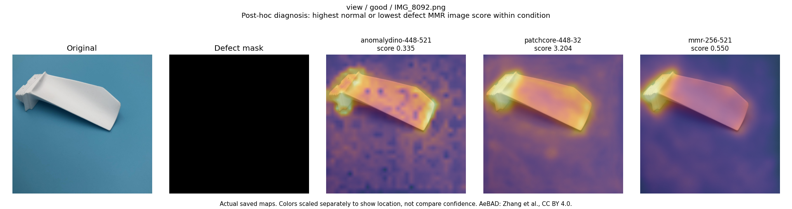
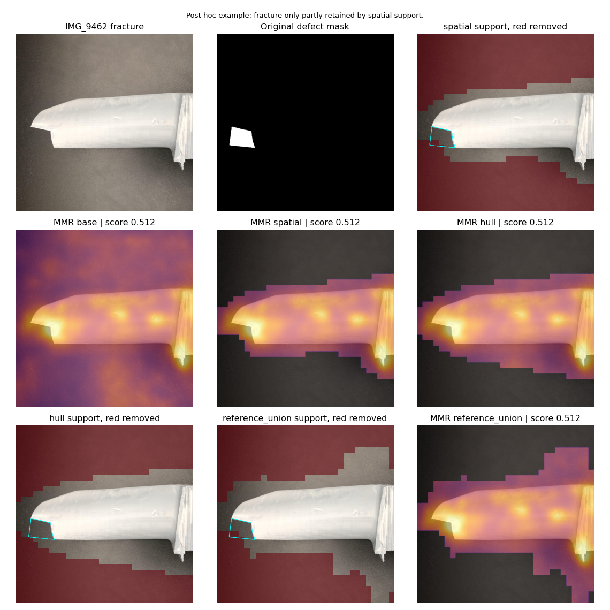

# Blade comparisons and unresolved failures

The AeBAD work includes two stages: an earlier comparison of MMR, AnomalyDINO and PatchCore, and the later three-repeat FastFlow application. The earlier comparison found a stronger reference. The later study fulfilled the flow-method application on the new domain, with poor results. Neither stage established a successful new detector.

## Completed local comparison

All three earlier references used 521 normal training images and the same 160 development images, balanced across four provider capture groups and five labels. The normal groups and four defect labels each contribute eight images per group. The 1,479 other AeBAD test images remain excluded. Each reference has one fitted model or memory construction, not three repeats.

| Method | Input | Image AUROC | Pixel AUROC | Pixel AP | PRO through 5% FPR | PRO through 30% FPR |
| --- | ---: | ---: | ---: | ---: | ---: | ---: |
| MMR | 256 | 85.64 | 91.68 | 10.89 | 63.02 | 89.25 |
| AnomalyDINO | 448 | 72.56 | 81.53 | 5.84 | 56.43 | 83.02 |
| PatchCore | 256 | 63.57 | 93.33 | 12.53 | 43.51 | 80.48 |

Scores are percentages, averaged equally across the four capture groups. PRO measures the fraction of each separate defect region recovered while varying the pixel false-positive allowance. The 5% version is stricter than the 30% version. Pixel AP weights pixels rather than giving every region equal influence. This helps explain why a method can lead one column without leading the others; it does not prove which individual defects caused every difference.

MMR learns to reconstruct normal feature descriptions after hiding portions during training. The idea is to use relationships between image areas, rather than rely only on whether an isolated patch resembles a stored normal patch. AnomalyDINO stores normal descriptions from a frozen DINOv2 network and compares new descriptions with them. PatchCore uses CNN features and a selected normal memory. MMR's contextual training is a plausible reason for its stronger result here, but the comparison changes several factors and does not isolate that mechanism.

MMR used the fixed epoch-200 endpoint from the author implementation at commit `22d1b171687509024e6f5b53b5a5e772d653d32b`, seed 54. The full-frame resize and native-mask evaluator differ from the authors' cropped evaluation. PatchCore used ImageNet V1 WideResNet-50-2 layer2/layer3 features, a 10% coreset and its nine-neighbor image-score weighting. AnomalyDINO used frozen DINOv2 S/14. These are documented AeBAD adaptations, not literal reproductions of published tables.

Each table row retains its original whole-image score rule. Using the maximum native-map score for all three gives image AUROCs of 85.64, 74.41 and 63.18 respectively. MMR's ranking advantage survives that scoring control. Different input sizes, feature extractors, fitting procedures and compute remain.

The old report written before full-population PatchCore finished is superseded by the completed table above. The later run built its memory in disk shards and retained all 521 training images in the declared construction. It was not left at the earlier 32-image reference.

The [saved comparison data](../evidence/aebad-development-comparison.json) include per-condition numbers, source hashes, masking controls and the previous verification receipt. The November 15 export independently checked the condition means and erased-region counts against saved JSON, and checked that evaluation paths and recorded image hashes match the later FastFlow manifest. It did not load a model, read a dataset image or recompute predictions.

## Why this does not yet explain the FastFlow failure

The later ResNet FastFlow study fitted 128 normal images and calibrated on another 32. Its final three-seed results were 44.24 image AUROC, 2.30 pixel AP and 14.66 PRO through 5% FPR. The earlier references had 521 fitting normals. Comparing their scores establishes that better working pipelines exist on this development sample; it does not separate the effect of method from the amount of normal training data.

The FastFlow normal-pixel false-positive rate was 13.62% overall, with 39.99% in the background group and 1.24% in the same group. Its errors therefore were not evenly distributed. The groups contain different photographs; physical blades and acquisition sessions are not verified independent or paired. Saying that a particular background caused the difference would go beyond the evidence. [Full FastFlow results](../../final-evidence/transfer-team-tables/README.md).

Increasing DINO's nested normal bank from 32 to 128 to 521 raised mean image AUROC from 65.04 to 66.21 to 72.56 and pixel AP from 5.01 to 5.18 to 5.84. Coverage mattered but did not close its gap to MMR. This is evidence for DINO under that selection rule, not proof that FastFlow will respond identically.

We have not completed the same AeBAD study for WideResNet FastFlow, EfficientNet FastFlow or the compact models. The seven-configuration benchmark was on MVTec. WideResNet is the most informative missing flow comparison because it was strongest there. Lower input resolution, limited normal coverage, feature suitability and training behavior are hypotheses about FastFlow's poor result, not established causes. A numerical audit found no collapse of all saved maps to constants; that excludes one simple numerical explanation, not every implementation or modeling problem.

## What the failure controls actually established

**High scores are not confined to the surrounding scene.** In the example below, the defect mask is empty because the blade is undamaged. MMR's rightmost map responds strongly at the attachment end on the left of the blade. Keeping the whole blade while removing distant background would keep that response.

This example was selected after scoring as the highest-scoring normal image in the view group for MMR. It illustrates a failure location, not its frequency. The PatchCore panel is the earlier 32-reference, 448-pixel control, not the full-population PatchCore row above. Map colors are scaled separately; raw scores from different methods are not comparable probabilities.

An earlier assistant visual audit placed 19 of the 32 normal-image MMR maxima on visible blade material, 11 on or next to a boundary, and two on separate scene structure. Those are provisional visual annotations, not expert ground truth or counts of thresholded false alarms. They need independent review before supporting a physical foreground/background claim.

**Removing background can remove damage.** The following example has a missing section near the left blade edge. The white annotation includes that missing material. The red overlay marks excluded image area. The expanded spatial mask cuts into the annotated region even though it broadly follows the visible blade.

All three displayed MMR variants keep the same whole-image score, 0.512, despite changing how much damage remains visible in the map. This is a selected diagnostic example, not an average. Both figures are unchanged saved overlays of AeBAD-S images and annotations, Zhang et al., CC BY 4.0.

| Masking control | Entire annotated regions excluded /240 | Fracture regions excluded /32 | Small regions excluded /144 |
| --- | ---: | ---: | ---: |
| Tight feature-based foreground estimate | 38 | 9 | 22 |
| Spatial dilation and closing | 33 | 6 | 22 |
| Wider convex outline | 4 | 0 | 2 |
| Union with an aligned normal-reference outline | 17 | 0 | 15 |

Small means at most 0.1% of native image area. Fracture and small subsets overlap. These counts measure whether the support mask excluded every pixel of an annotated region; they are not counts of previously detected regions lost. Dilation expands the mask, closing fills small gaps, and a convex outline fills larger inward gaps. The last control adds the estimated outline from an aligned normal example.

The wider outline raised MMR image AUROC from 85.64 to 86.72 and PRO5 from 63.02 to 63.54, but still excluded defects. Its paired image-AUROC interval included zero. The simple alignment control did not beat it. These forced foreground controls do not reproduce stronger SAM/Matcher masking or prove that all masking methods fail. They show why an average gain is insufficient evidence of defect preservation.

## Published results and released methods

Primary sources checked November 15, 2026. Published benchmark numbers below use their authors' protocols, not our balanced 160-image development set. They are not additional results from this project, and they cannot be merged with our table to claim a state-of-the-art ranking.

| Work | Reported AeBAD-S result | Mechanism and release status |
| --- | --- | --- |
| [MMR](https://arxiv.org/abs/2304.02216) | 84.7 image AUROC; 89.1 AUPRO in the cited benchmark table | Masked reconstruction learns relationships between normal feature patches. [Author code](https://github.com/zhangzilongc/MMR) is released; our trained adaptation is already available. |
| [MiniMaxAD](https://arxiv.org/abs/2405.09933) | 87.0 image AUROC in the comparison reported by MMR+++ | Feature reconstruction with a large-kernel network. [Author code](https://github.com/WangFengJiee/MiniMaxAD) includes an AeBAD training entry point. The instructions require training and link backbone weights; this review did not verify a ready-trained AeBAD detector checkpoint. |
| [MMR+++](https://arxiv.org/html/2606.09670v1) | 88.2 image AUROC; 90.2 AUPRO | Foreground masks, teacher adaptation and synthetic normal images. A runnable author code/checkpoint release was not established in this review. Its gains already overlap broad masking/adaptation proposals. |
| [NFAD](https://arxiv.org/html/2608.29112v1) | 91.0 image AUROC; 90.8 AUPRO; 11.7 pixel AP | Estimates nuisance variation from normal-image perturbations and uses different suppression rules for image detection and pixel localization. The paper and [author page](https://nhphan.github.io/) were located; a runnable author release was not verified. It is listed as under review on that page. |

NFAD is the highest image-AUROC result among these inspected primary reports, not a verified exhaustive current leaderboard. Its own table still reports higher pixel AP for RAD and PatchCore, and its text identifies small-defect pixel precision as a limitation. A benchmark leader on image ranking is not necessarily the best localized inspection system.

These papers already address important parts of the proposed problem. Generic background removal or lighting suppression is not an unoccupied contribution. [CostFilter-AD/UCF](https://github.com/ZHE-SAPI/CostFilter-AD) also supplies learned matching-cost refinement. Our earlier source audit ran its filtering module with synthetic features, but did not establish the required trained checkpoint or reproduce its anomaly results. That smoke test is not evidence that we tested or beat UCF on blades.

## The next unanswered comparison

The immediate gap in our experiments is **ResNet versus WideResNet FastFlow on blades with the same fitting and calibration images**. A frozen comparison would keep input size, evaluation images, endpoint and metric implementation fixed, disclose remaining architecture/recipe differences, and report capture groups, normal false alarms, small regions and fractures. If resources require a shorter endpoint, both arms need that same endpoint and the result remains a pilot.

An improvement would show that our MVTec backbone finding carries into this application. No improvement would narrow the explanation toward other modeling or data factors. Neither outcome by itself creates a novel algorithm. After that, only one supported cause should be tested at a time, rather than changing backbone, resolution, normal coverage and scoring together.

For a method contribution, the unresolved goal is more demanding: improve small-defect localization under capture changes over a strong reference while controlling false alarms and retaining fracture evidence. The current experiments do not establish a new mechanism that achieves this, and recent literature already addresses the broad trade-off. Any proposal needs a precise difference from that work, a runnable comparison and independent confirmation data before expansion. The reserved AeBAD images remain excluded.

[Weekly project notes](../PROJECT-WALKTHROUGH.md) · [Open questions](../PROJECT-WALKTHROUGH.md#open-questions-and-remaining-work)
