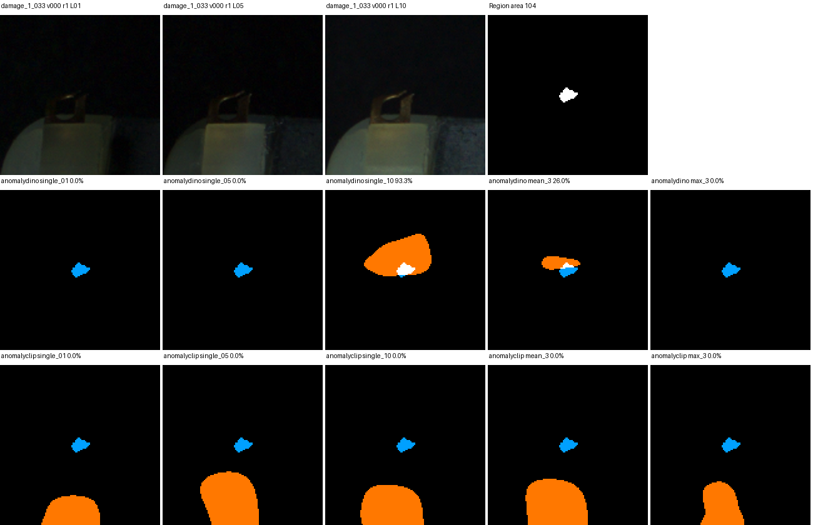

# Earlier AnomalyDINO Motor exploration

AnomalyDINO uses a pretrained DINOv2 image reader and normal reference features. We used released weights; DINO was not trained from scratch. This earlier exploration is separate from the seven-configuration FastFlow/PatchCore study.

The declared fresh development sample contained 90 RGB images: 15 released Motor IDs, two views and three lighting conditions. Nine IDs were anomalous and six normal. The released masks contained 30 connected defect regions, 29 small. Those regions are not 29 independent objects. The comparison reused previously fixed normal-calibrated thresholds.

| Control | AnomalyDINO small regions detected, out of 29 | AnomalyCLIP small regions detected, out of 29 |
| --- | ---: | ---: |
| Light 01 | 21 | 9 |
| Light 05, fixed comparator | 17 | 11 |
| Light 10 | 24 | 7 |
| Mean of three lights | 24 | 10 |
| Maximum of three lights | 20 | 13 |

DINO averaging retained all regions detectable under any single light. DINO maximum lost four against the best available single-light detections, but lost none against the fixed light-05 comparator. Three regions were missed by both models under all five controls. This does not support a universal claim that every stronger model suffers the same small-defect losses.

In this 104-pixel region, DINO's light-10 prediction covers 93.27% of the annotated damage, averaging covers 25.96%, and maximum aggregation covers 0%. Each method has its own fixed calibration threshold. Maximum aggregation can raise raw scores while losing a detection after that threshold changes. White is detected annotated damage; cyan is missed damage; orange is a flagged pixel outside the annotation.

For averaging, normal-pixel false-positive rates were 0.418% for DINO and 1.157% for CLIP. Different achieved false-positive rates, backbones, supervision and preprocessing prevent a universal architecture ranking. This small sample also lacks fracture coverage.

References: [AnomalyDINO](https://arxiv.org/abs/2405.14529), [AnomalyCLIP](https://arxiv.org/abs/2310.18961), and the [pinned M2AD dataset release](https://huggingface.co/datasets/ChengYuQi99/M2AD/tree/05abc5d03167354a7ef98541236b5c0bd00abadf). Dataset attribution follows the M2AD card's Apache-2.0 declaration. The existing diagnostic is reused unchanged.

[Project guide](../README.md)
