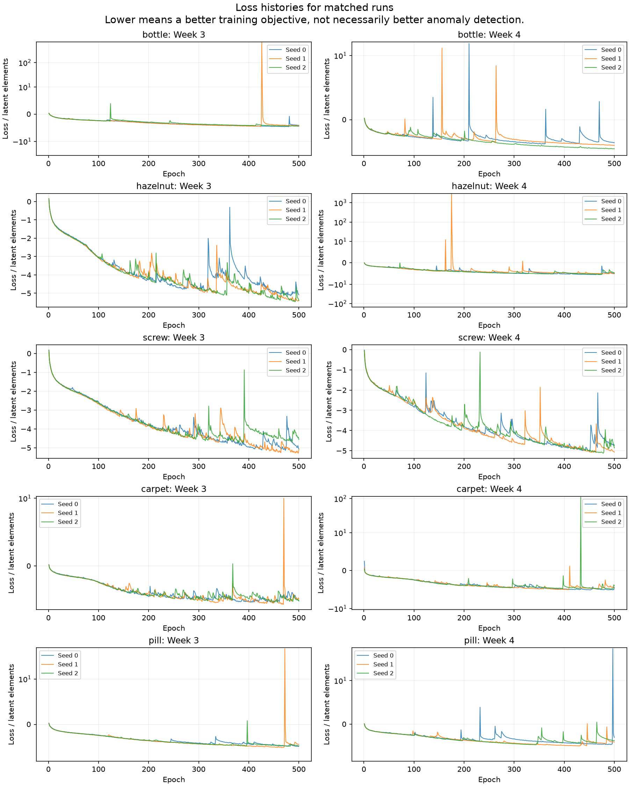
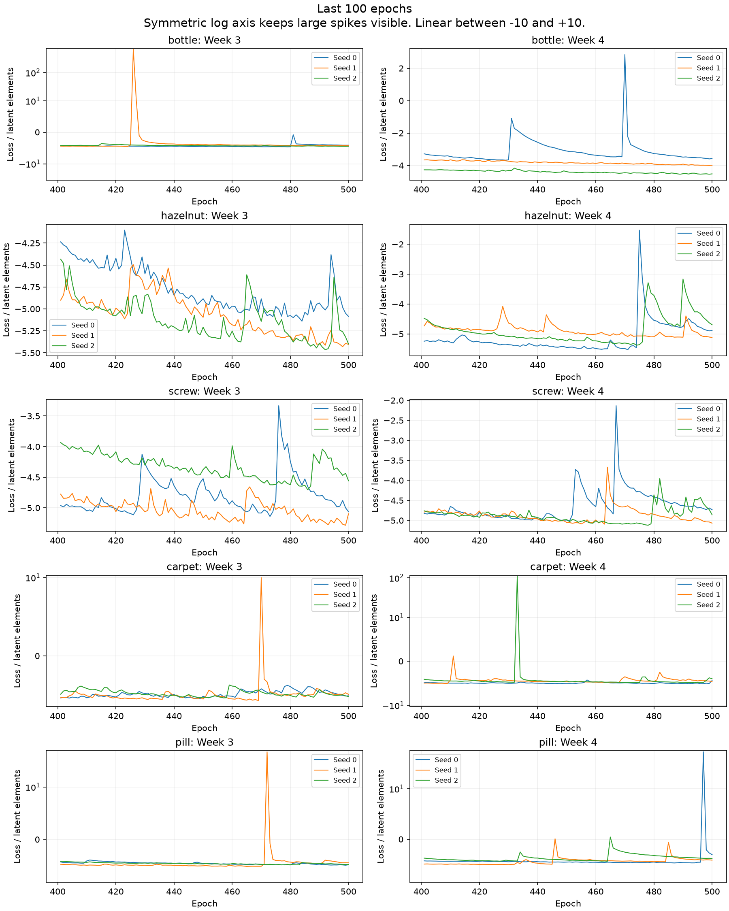

# Looking more closely at the Week 4 results

We compared 30 training histories across bottle, hazelnut, screw, carpet and pill. We also put the same test images beside each other for both configurations and all three seeds. There are signs of late training instability in some runs, and examples where background responses still interfere with the image score. These are different problems, and the evidence does not point to one explanation for every weak category.

## What the loss curves show

Pill seed 0 is the clearest case to investigate. Its training loss jumped from about -8.27 million at epoch 496 to +118.70 million at epoch 497. By epoch 500 it had returned to -5.53 million, still worse than immediately before the spike. Its image AUROC was 76.57%, compared with 95.77% and 94.74% for the other two seeds. Pixel AP was also much lower, at 18.95% versus 58.46% and 50.78%. Seed 0 was worse on every pill defect group, so the drop is not limited to one defect type.

That is evidence of a sharp disturbance near the end of training. It makes the final model state a plausible contributor to the result. It does not prove that the spike caused the AUROC drop because we did not save test predictions immediately before and after it. The log shows this run resumed at epoch 401, then continued through the spike and finish. The spike was not at the resume boundary.

Carpet seed 0 also had an upward loss step at the very last epoch, from about -9.26 million to -8.00 million. But it had the lowest average training loss over the final 50 epochs of the three carpet runs and still had the worst image AUROC. Fitting the normal training features better does not necessarily produce better separation of normal and defective test images.

Large spikes alone do not predict a bad final model. Hazelnut seed 1 had a much larger spike at epoch 175 and still had the best Week 4 hazelnut image AUROC. Week 3 bottle seed 1 also had a large spike and finished at 100% image AUROC. Timing, recovery and the model's response on new images matter.

The earlier checks established that the saved files and calculations agree. Finite losses and 500 recorded epochs did not establish that training was smooth or stable throughout.

Loss is divided by the number of latent elements to make the curves easier to read. The backbone features and their distributions still differ, so these normalized values are not a common quality score across backbones. Lower loss means a better training objective, not better anomaly detection. The symmetric log axis keeps the large spikes visible without flattening the negative part of the curves. Values between -10 and +10 use a linear scale.

## What changes on the same images

The matched gallery is at `results/week4/followup/index.html`. Each comparison shows the input, supplied defect mask and six predictions. The cyan cross marks the highest-scoring pixel, which determines the image score. The green contour outlines the defect mask. Each map is scaled separately for display, so compare response locations rather than brightness.

For a defective image, ranking error is the fraction of normal images that score above it. For a normal image, it is the fraction of defective images that score below it. Ties count as half. Lower is better. This is not a classification error rate at a chosen threshold.

| Example | What the comparison shows |
| --- | --- |
| Screw, `test/good/014.png` | All six predictions peak in the top-right background. In Week 4 this normal image still ranks above 79.0%, 32.8% and 92.4% of defective images. Changing the configuration did not remove this failure consistently. |
| Screw, `test/scratch_neck/023.png` | The small neck defect becomes more distinct in Week 4 seeds 1 and 2. Ranking error falls from 95.1%, 97.6%, 87.8% to 80.5%, 26.8%, 14.6%. Seed 0 remains weak. |
| Hazelnut, `test/good/001.png` | All six predictions peak in the background above the object. Week 4 improves its ranking, but it still scores above roughly three quarters of defective images. |
| Hazelnut, `test/crack/013.png` | Week 4 responses follow more of the supplied crack mask and all three peaks fall on the marked crack. Ranking error improves from 80%, 80%, 85% to 52.5%, 40%, 57.5%. Better localization still does not make this an easy image to rank. |
| Carpet, `test/thread/018.png` | Week 4 seed 0 peaks at the image border rather than the marked thread. Its ranking error is 85.7%, compared with 32.1% and 53.6% for seeds 1 and 2. |
| Pill, `test/combined/012.png` | All six runs rank this image above every normal image and respond near the defects. Even the weak pill run has examples that work. |

The gallery includes 23 examples. For each category, we selected the normal and defective image with the highest and lowest average ranking error across the six runs. We also retained the four images from the Week 3 walkthrough. These are selected test examples for inspection, not a representative sample or new evaluation set. The category-wide scores remain the main results.

## What this explains and what it does not

The comparisons support two observations: some defects are represented more clearly by the Week 4 configuration, and unwanted background or border responses can still determine the image score. Pill seed 0 also gives us a concrete training-stability issue to investigate. We have not established whether the remaining responses come from a particular feature level, the way maps are combined, the learned flows, or other implementation choices.

Keep the existing final-checkpoint results. Replacing weak seeds with better reruns would hide the variability. A separate stability experiment could compare a fixed learning-rate schedule or gradient clipping, with the choice made in advance and applied to every compared run. It should not be mixed into the multi-scale experiment.

Finished Week 4 runs retain their final models, but their intermediate recovery checkpoints were removed by the training script. We cannot replay pill just before epoch 497 from those files. Future training experiments should retain a small, fixed set of late checkpoints and record per-level losses and gradient norms. That would let us investigate when the predictions change without selecting checkpoints by test performance.

Week 5 should first expose the individual feature-level maps and compare their contribution while holding each trained model fixed. The [Week 5 plan](../../docs/WEEK5_PLAN.md) sets out that experiment and a separate fusion candidate.

## Files and repeatability

- [Loss measurements](followup/loss_summary.csv)
- [Ranking errors for every test image in the five inspected categories](followup/image_ranking.csv)
- [Selected images and the selection rule](followup/selected_images.csv)
- [Defect scores for each run](followup/defect_scores.csv)
- Local matched gallery: `results/week4/followup/index.html`

Run `python scripts/week4_followup.py` from the repository folder to regenerate the figures, tables and gallery. It reads the saved histories, scores and maps. It does not train or use the GPU. The observations here are a separate written interpretation of those outputs.

Example images are from MVTec AD under [CC BY-NC-SA 4.0](https://www.mvtec.com/research-teaching/datasets/mvtec-ad). The full gallery stays with the local results, outside Git.
