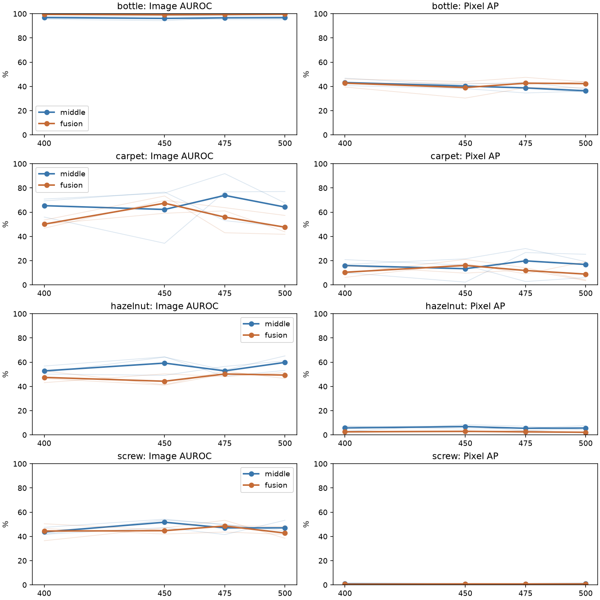

# What the retained Week 5 checkpoints show

[Week 5](../README.md) | [Comparison](../../comparison/README.md)

We evaluated bottle, carpet, hazelnut and screw at epochs 400, 450, 475 and 500 for both variants and all three seeds. These categories were chosen after inspecting the final results to cover a relative gain, a texture regression and persistent weak categories. This is a diagnostic subset, not a new full-study endpoint or an independent validation set.

All 96 evaluations finished. All 24 final-checkpoint replays matched the saved maps exactly. The original epoch-500 metrics remain the published result. We report every retained checkpoint instead of choosing whichever gives the best test result.

## Pixel AP through late training

Values are category means across the three seeds, in percent.

| Category | Model | Epoch 400 | Epoch 450 | Epoch 475 | Epoch 500 |
| --- | --- | ---: | ---: | ---: | ---: |
| bottle | middle | 43.19 | 40.25 | 38.75 | 36.39 |
| bottle | fusion | 42.70 | 39.03 | 42.68 | 42.31 |
| carpet | middle | 15.94 | 13.32 | 19.80 | 16.82 |
| carpet | fusion | 10.41 | 16.03 | 11.86 | 8.87 |
| hazelnut | middle | 5.70 | 6.80 | 5.41 | 5.64 |
| hazelnut | fusion | 2.53 | 2.88 | 2.52 | 2.10 |
| screw | middle | 0.93 | 0.73 | 0.74 | 0.89 |
| screw | fusion | 0.54 | 0.77 | 0.74 | 0.77 |

Thick lines show the three-seed average. Faint lines show individual seeds. Lines connect sampled checkpoints and do not reveal behavior between them.

## Interpretation

Hazelnut fusion remains around 2 to 3% pixel AP throughout these checkpoints, and screw stays below 1%. Their weak localization was already present at epoch 400. Choosing a nearby late checkpoint would not explain away the problem or recover Week 4 performance.

Carpet is unstable across checkpoints and seeds. For example, middle seed 0 rises to 91.81% image AUROC at epoch 475, then falls to 67.66% at epoch 500. Fusion seed 2 reaches 73.35% at epoch 450 and finishes at 41.73%. This is evidence that the endpoint can matter substantially in this category. It does not prove a particular optimizer setting caused the fluctuations.

Bottle middle-only AP declines from 43.19% to 36.39% between the first and last retained checkpoints. Fusion is approximately level, 42.70% to 42.31%, though individual seeds fluctuate. The final bottle fusion gain over its control partly reflects the control's late decline. That still leaves fusion well below the original Week 4 bottle AP of 77.05%.

These results narrow the explanation. There is evidence of late variability and some deterioration, but no single last-epoch failure explains all categories. We lack earlier retained checkpoints to determine when the weak representations first became ineffective. A future training study should sample earlier milestones, use a declared development rule and preserve the complete trajectory.

[Every evaluation](per_run.csv), [category means](means.csv), and [replay checks](checks.json) are included. Run `python scripts/week5_checkpoints.py` with the original local outputs and CUDA to repeat this check. It does not train or change the original result files.
