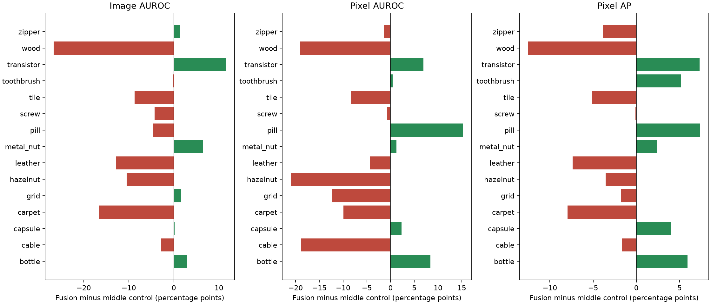
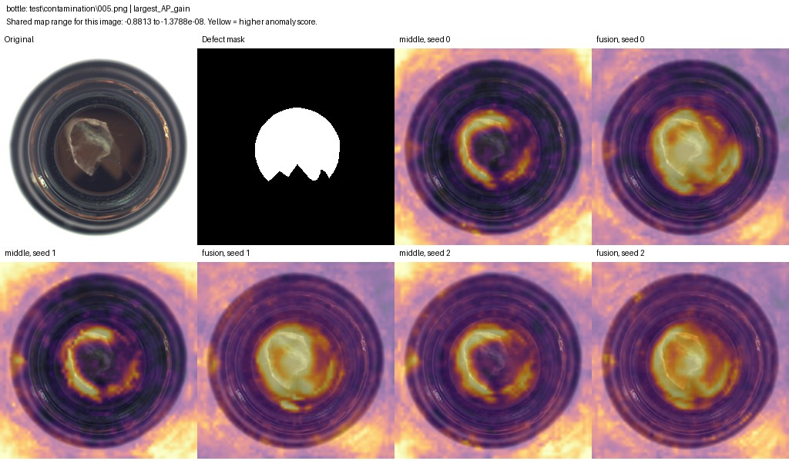
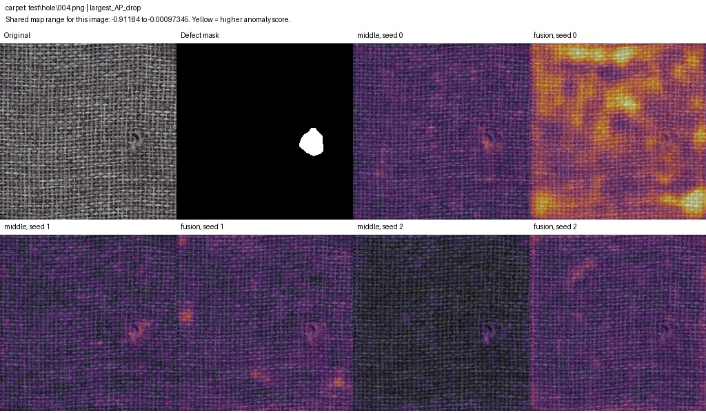
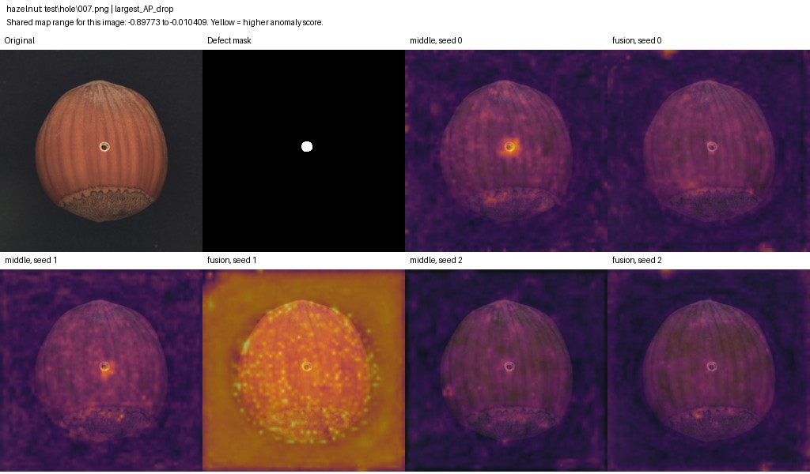
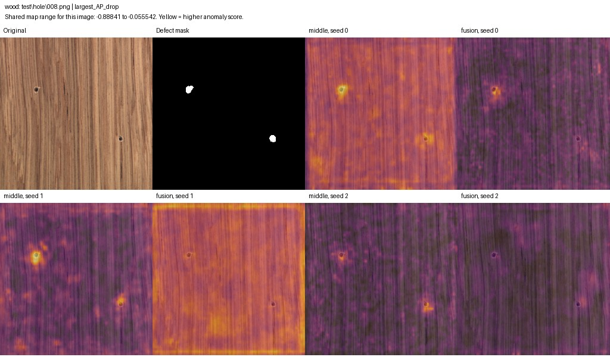
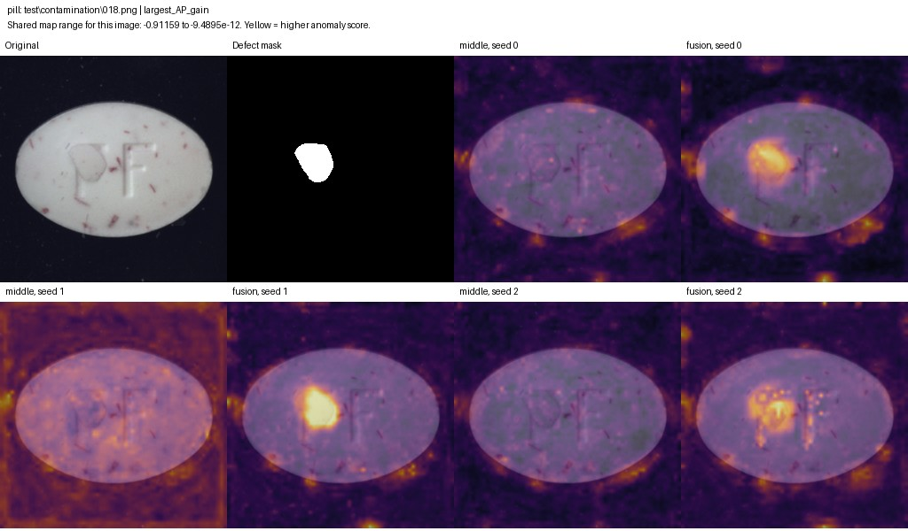
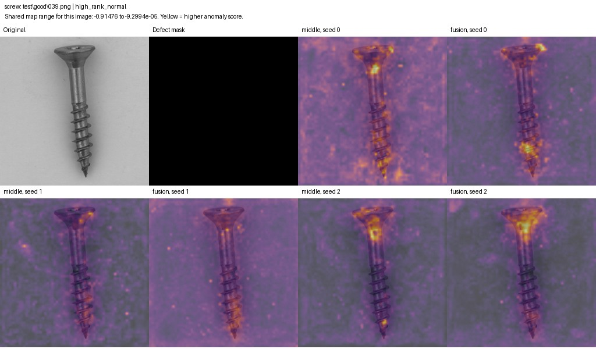

# Week 5: design, evidence and interpretation

The new feature-fusion model did not improve the overall results. It helped on some categories and some individual defects, but lost more elsewhere. The original Week 4 FastFlow remains our strongest tested configuration. This report explains the fusion design, its results and what remains unresolved.

[Week 5 overview](README.md) | [All-week comparison](../comparison/README.md) | [Heatmaps](HEATMAPS.md)

The earlier experiments and metric definitions are explained in the [comparison](../comparison/README.md). Here we focus on the fusion question and its evidence.

## Week 5: what fusion actually changed

FastFlow already used three backbone levels. In the original configuration, a separate flow processed each level, then their anomaly maps were averaged. Our experiment asked whether making several levels available to one flow before it scores them would help.

We used PCA, a fixed linear compression fitted only on normal training features, to keep the new model small enough for the experiment. PCA retains directions with high variation in the training features. Those directions are not guaranteed to be the best ones for finding defects.

| Setting | Middle-only control | Fusion |
| --- | --- | --- |
| Features | 96 PCA components from the middle level | 32 components from each of the fine, middle and coarse levels |
| Flow input | 96 channels on a 64 by 64 grid | Same |
| Trainable model | One normalization layer and one eight-block flow | Same |
| Trainable parameters | 1,065,600 | 1,065,600 |
| Training | 500 epochs, effective batch 32 | Same |
| Image score | Maximum map value | Same |

The paired models used the same starting flow parameters and training order for each seed. We standardized the projected components using normal training statistics. Coarser maps were resized to the common grid. Test masks were not used to fit PCA or train the flow. The protocol was fixed before the full runs.

This is a reasonable controlled question: does a mixture of levels help at a fixed channel budget? It is not a test of every possible fusion architecture. The 96-channel budget and equal 32-channel allocation are practical starting choices, not established optimal settings. Fusion also has fewer middle-level components than the control, so the comparison includes that tradeoff.

The short pilots established that the code ran, fit memory and resumed correctly. They did not establish that 500-epoch training would be stable or that this design would achieve good accuracy.

## Why these layers and this structure

The backbone supplies `layer1`, `layer2` and `layer3`, with tensors of 256 x 64 x 64, 512 x 32 x 32 and 1,024 x 16 x 16. These are the same stages used by our Week 4 FastFlow extractor. They correspond to increasingly coarse spatial grids. A coarse grid generally carries broader context, but it does not guarantee that a feature has a useful semantic interpretation for a particular defect.

[FastFlow, Section 4.7 and Table 6](https://arxiv.org/html/2111.07677v2) uses the first three ResNet stages and combines their output maps. That is the basis for retaining these stages. We did not search over arbitrary backbone layers or test a fourth stage. Keeping the existing stages also avoids changing the feature extractor while asking how to combine its information.

The [five-category level inspection](levels.md) showed that the levels were not interchangeable. For example, screw image AUROC was 48.88%, 67.81% and 72.99% for the individual fine, middle and coarse outputs. Hazelnut also benefited from the coarse output in that exploratory inspection. This motivated testing how levels interact. It did not establish that equal input budgets or our fusion mechanism were best, and it was already informed by the test set.

The intended mechanism was straightforward: a local irregularity might look less suspicious when broader context identifies it as normal structure, while a true defect might produce complementary signals at several levels. Giving the features to the same flow allows interactions before scoring. This is the hypothesis we tested. The data did not support a general improvement from this implementation.

| Decision | Why it was reasonable to try | What it does not establish |
| --- | --- | --- |
| Use the existing three stages | Preserve the feature sources and span three resolutions | These are not proven optimal layers for our new architecture |
| Middle-only control | A single intermediate-resolution source, avoiding a control with extra levels | It is not the strongest possible single-level control |
| Fixed PCA fitted on normal training data | A reproducible way to lower the channel and memory cost without defect labels | High normal variance is not the same as useful anomaly information |
| 96 total components | Keep the full paired experiment computationally practical | We did not establish an accuracy-preserving compression threshold |
| 32 components per level | Give each source a simple equal channel budget | Equal channel counts do not preserve equal information fractions |
| Standardize components | Reduce differences in numeric scale before concatenation | It can increase the relative influence of low-variance components |
| Align at 64 by 64 | Keep the finest chosen grid rather than downsampling it immediately | Resizing coarse maps creates correlated samples, not new detail |
| One shared flow | Directly test interaction before scoring at a matched downstream size | It changes density modeling substantially relative to three independent flows |
| Same optimizer and 500 epochs | Keep paired runs comparable and use an established schedule | A schedule suitable for the original model need not suit this smaller representation |

There is substantial compression. The middle control keeps 96 of 512 channel directions. Fusion keeps 32 of 256, 32 of 512 and 32 of 1,024. Those are component counts, not percentages of retained variance. We did not record enough information to claim a particular retained-variance threshold. Also, fusion trades 64 middle-level components for fine and coarse components. It does not add extra levels while preserving all of the control's information.

### Why not another fusion method?

| Alternative | What it would test | Why it was not this first experiment |
| --- | --- | --- |
| Change weights on the three output maps | Whether a different score combination helps | It does not test joint feature modeling before the flow |
| Concatenate all uncompressed channels | Joint modeling with less compression | It would be much more expensive and would not match the small control's capacity |
| Learn a projection or attention mechanism | A data-adaptive combination | It introduces another trainable component and another optimization question |
| Use a coarser shared grid | Lower spatial cost and different alignment | It trades away fine spatial resolution and needs a separate comparison |
| Implement MSFlow | A published multi-scale architecture | It is a larger method change with its own reproduction work |

These are tradeoffs, not evidence that we chose the best alternative. In particular, [MSFlow](https://arxiv.org/abs/2308.15300) uses asymmetric parallel flows followed by a fusion flow, rather than this PCA-concatenation design. Its [official implementation](https://github.com/cool-xuan/msflow) is a useful next reference. [CFLOW-AD](https://arxiv.org/abs/2107.12571) also motivates multi-scale feature modeling through conditional flow decoders, but our experiment does not reproduce CFLOW-AD.

### Two structural limitations worth testing

Only 279,168 of the 1,065,600 trainable parameters belong to the flow. The remaining 786,432 are the scale and bias of a LayerNorm over 96 x 64 x 64 elements. Both variants have this same parameter allocation. Matching the total is a useful control, but much of that capacity is position-specific normalization rather than interactions in the flow. This gives a concrete reason to test normalization choices. It does not prove those parameters caused the failure, and the original FastFlow implementation also uses spatial LayerNorm.

Upsampling is another structural issue. The control starts with a 32 by 32 grid, then is deterministically interpolated to 64 by 64. The new values cannot be independent measurements. The fusion input similarly contains interpolated middle and coarse channels. In principle, such constraints change the geometry of the input distribution that the flow must fit. This is a hypothesis about representation and optimization, not a diagnosed numerical bug. A spatial-resolution ablation would need to account for the normalization parameter count changing too.

PCA and normalization are outside the invertible flow. This is therefore a flow on transformed features, not an invertible image model or an exact density over the original backbone representation. We should describe it that way in the report.

## Full comparison

All 90 runs finished: 15 categories times three seeds times two input variants. No weak run was replaced, and no checkpoint was chosen by test performance.

| Metric | Middle-only control | Fusion | Change |
| --- | ---: | ---: | ---: |
| Image AUROC | 71.76 ± 3.39% | 67.55 ± 1.66% | -4.21 points |
| Pixel AUROC | 73.89 ± 1.41% | 69.80 ± 1.68% | -4.09 points |
| Pixel AP | 14.57 ± 1.68% | 13.79 ± 1.04% | -0.78 points |

Fusion reduced overall image AUROC and pixel AUROC for all three paired seeds. Pixel AP changed by -3.20, +1.19 and -0.32 points for seeds 0, 1 and 2 respectively. Its overall change was -0.78 points, so the primary metric provides no evidence of an overall benefit here.

Six of the 15 categories improved in mean pixel AP, and all six improved in all three paired seeds: bottle, capsule, metal nut, pill, toothbrush and transistor. Nine categories declined on average. Some gains remain weak in absolute terms. For example, transistor fusion pixel AUROC is only 50.29%, despite improving over its control.

Both new variants are substantially below the original Week 4 model. That matters as much as the difference between them. Compression, standardization, spatial resizing and replacing three flows with one all changed relative to Week 4. We cannot blame the entire drop on fusion, or conclude that multi-scale information is generally unhelpful.

### Texture and object categories

All five texture categories lose mean pixel AP, while object categories gain 2.30 points on average. Texture AP falls by 6.94 points. This post-hoc distinction motivates a more specific question about dense texture information, but does not justify dropping textures from the benchmark. The overall AP change is small enough that removing wood makes it slightly positive. The overall image and pixel AUROC declines remain negative when any single category is removed. See the [sensitivity analysis](../comparison/README.md#is-one-category-deciding-the-conclusion).

### Every category

Values below are means across three seeds. Changes are fusion minus the middle-only control, in percentage points. Full values and seed variation are in the [category table](analysis/per_category.csv).

| Category | Middle image AUROC | Fusion image AUROC | Image change | Pixel AUROC change | Pixel AP change | AP seed wins |
| --- | ---: | ---: | ---: | ---: | ---: | ---: |
| bottle | 96.72% | 99.60% | +2.88 | +8.43 | +5.91 | 3/3 |
| cable | 55.63% | 52.77% | -2.86 | -18.86 | -1.64 | 0/3 |
| capsule | 84.58% | 84.71% | +0.13 | +2.33 | +4.04 | 3/3 |
| carpet | 64.22% | 47.61% | -16.61 | -9.94 | -7.95 | 0/3 |
| grid | 54.64% | 56.22% | +1.59 | -12.33 | -1.74 | 0/3 |
| hazelnut | 59.81% | 49.32% | -10.49 | -20.98 | -3.54 | 0/3 |
| leather | 69.17% | 56.36% | -12.81 | -4.41 | -7.38 | 0/3 |
| metal_nut | 68.82% | 75.32% | +6.50 | +1.26 | +2.41 | 3/3 |
| pill | 71.23% | 66.62% | -4.61 | +15.28 | +7.39 | 3/3 |
| screw | 47.05% | 42.75% | -4.30 | -0.73 | -0.12 | 1/3 |
| tile | 63.18% | 54.44% | -8.74 | -8.41 | -5.11 | 0/3 |
| toothbrush | 93.15% | 92.96% | -0.19 | +0.43 | +5.14 | 3/3 |
| transistor | 69.86% | 81.42% | +11.56 | +6.92 | +7.32 | 3/3 |
| wood | 85.47% | 58.83% | -26.64 | -19.01 | -12.51 | 0/3 |
| zipper | 92.87% | 94.26% | +1.39 | -1.34 | -3.87 | 2/3 |

## What the actual heatmaps show

These images were rendered from the saved predictions of the completed runs. They are not illustrations or new model outputs. Each panel shows the original image, supplied mask and both models for all three seeds. Yellow indicates a higher anomaly score. The mask is the target location, not a prediction.

Each comparison uses one numeric color range across its six maps. Brightness is not calibrated confidence, and color ranges differ between image comparisons. A brighter overlay does not by itself mean better localization. The quantitative comparisons use raw maps, not these display colors.

Bottle, contamination 005: fusion follows much more of the central contamination in all three seeds. Mean per-image AP rises from 18.28% to 74.19%. This is a real example-level gain, but the category still has worse localization than Week 4.

Carpet, hole 004: the control gives the hole a more distinctive response. Fusion seed 0 responds broadly to normal texture, and the other fusion maps do not recover the same ranking quality. Mean per-image AP falls from 34.04% to 3.89%.

Hazelnut, hole 007: the control highlights the small hole most clearly in seeds 0 and 1. Fusion weakens that response, with a broad response across the object and background in seed 1. Mean per-image AP falls from 39.10% to 3.28%.

Wood, hole 008: the control responds around both holes, although it also responds elsewhere. Fusion does not consistently preserve both defect responses. Mean per-image AP falls from 48.45% to 9.08%.

Pill, contamination 018: fusion concentrates a response around the supplied mask in all three seeds. Mean per-image AP rises from 2.34% to 72.29%. Pill category pixel AP improves, but its image AUROC declines. Finding a defect within an image and ranking defective images above normal images are different tasks.

Screw, normal image 039: there is no defect mask. Both models respond to ordinary screw structure and surrounding texture. Fusion has not solved false alarms on normal screws. Across the category its image AUROC is 42.75%, and pixel AP is only 0.77%.

A gain is not universal even within a strong category. Bottle broken-large 003 loses 28.56 points in mean per-image AP, with broad fusion responses outside the supplied mask. The full gallery includes that counterexample as well as the bottle gain.

The local gallery contains 45 comparisons, three for every category. For each category it includes the defective image with the largest average per-image AP gain, the one with the largest drop, and a normal image with a high average fusion score rank. Those are deliberately selected diagnostic examples. They are not a random sample and cannot replace the complete category results. If every image improves or worsens, the selection labels still refer to the largest and smallest change.

### Does fusion help smaller defects?

The descriptive size breakdown does not show a broad small-defect benefit. These bins use defect area after mask resizing and were used only for analysis, not model selection. Values average per-image AP across defective images and seeds. They are different from the category-wide pixel AP metric above, and category composition differs between bins.

| Defect area in image | Defective images | Middle per-image AP | Fusion per-image AP |
| --- | ---: | ---: | ---: |
| up to 0.1% | 16 | 6.35% | 8.42% |
| 0.1% to 1% | 483 | 10.99% | 8.88% |
| 1% to 5% | 517 | 21.44% | 18.82% |
| over 5% | 242 | 31.22% | 28.07% |

Only the smallest bin improves, and it contains just 16 images. That is insufficient for a general claim that fusion helps tiny defects. Across all defective test images and seeds, the maximum lies inside the mask in 29.41% of control predictions versus 21.60% of fusion predictions. It lies in the outer 16-pixel image border in 22.81% versus 39.59%. These are descriptive pooled counts, not threshold-based false-positive rates, and some defects can touch the border. They support investigating misplaced peaks but do not identify their cause. See the [size breakdown](analysis/defect_area.csv) and [peak locations](analysis/peak_locations.csv).

## What the checks establish

We verified all 90 completion receipts and their saved-file hashes, the frozen study source hashes, and the 15 saved PCA projection hashes. All 90 histories contain 500 finite recorded epochs. All 45 paired initializations match, and all 90 recorded checkpoint-reload and frozen-backbone checks passed.

We recalculated image AUROC, pixel AUROC and pixel AP from the saved maps and original masks for every run. They reproduce the saved metrics to within 1e-12. Maximum image scores match exactly, and image order and labels match across the paired outputs. Defect-group image AUROCs also match.

There is no wholesale collapse to all-zero maps. The largest fraction of exactly zero map pixels in any run is 0.180%. Some image scores are tied, however. Bottle fusion seed 2 has 66 unique scores across 83 images. The calculations retain these ties rather than perturbing them. We have not ruled out every numerical effect, but the broad performance drop is not explained by all maps being constant. None of the PCA standard deviations used the configured lower-bound floor.

These checks establish that the recorded outputs and calculations agree. They do not prove that the new architecture is well designed, that optimization converged to a useful solution, or that there is no implementation error upstream. The saved-map analysis was followed by a separate replay of all three seeds and both variants for four categories. All 24 final-model replays matched the saved maps exactly. This is not a replay of all 90 final models. The [checkpoint report](checkpoints/README.md) also evaluates the retained earlier models.

## Why might the new models be weaker?

The evidence points to problems worth separating, not one confirmed explanation.

1. **The representation changed substantially.** Both new variants are much worse than Week 4. The shared compression and single-flow design therefore deserve investigation before adding more elaborate fusion. PCA selects high normal variance, which can discard useful defect information. That is a plausible mechanism, not a measured cause here.
2. **Some maps respond broadly away from defects.** The carpet and hazelnut examples show this directly. Such responses hurt localization and can dominate a maximum-pixel image score. Other images show useful defect responses, so it is not a universal failure to recognize any defect.
3. **Training quality needs closer inspection.** Finite losses and exact resume do not imply smooth or useful learning. Some histories contain substantial late changes. For example, wood middle seed 1 has its largest upward loss step at epoch 492, and wood fusion seed 1 at epoch 493. A lower training loss also does not guarantee better test ranking. We have not demonstrated that these changes caused the poor results.
4. **Scale allocation is only one choice.** Equal channels per level do not mean equal useful information. Coarse features gain no new detail when enlarged, and fine features can include nuisance texture. This experiment does not isolate channel allocation, interpolation and level content from one another.

We should not explain the result as simply needing more epochs, attribute it to pauses without evidence, or rerun weak seeds until they improve. A predeclared repeat to investigate a suspected problem is useful, but the original run should remain reported. The existing results stay in the report.

## Relation to the earlier experiments

The [cross-week analysis](../comparison/README.md) compares all four configurations, shows the same images, and discusses the separate Week 4 scoring experiment. That scoring check does not alter these Week 5 results.

## What we can say in the midterm

> We established FastFlow baselines on all 15 MVTec AD categories with three seeds per category. The WideResNet configuration improved our overall results over ResNet-18, although an image-level gap from the published reference remains. We then tested a compact feature-fusion model against a capacity-matched middle-level control. Fusion did not improve the overall metrics, despite gains on individual categories and examples. Both compact models were substantially weaker than the original FastFlow configuration. The results motivate checking representation compression and training behavior before treating this design as an improvement or extending it to a new domain. A separate exploratory analysis also showed that image-score aggregation materially affects the Week 4 image-level result.

This gives us a complete experimental comparison to discuss, including a negative result. It does not establish a publication contribution or resolve the reproduction gap. The report still needs the team's literature discussion, requirement check and final write-up. EfficientNet-B4 and domain transfer should be described as pending if they remain part of the agreed plan, not as completed experiments.

## What to do next

The [retained-checkpoint diagnosis](checkpoints/README.md) has now been run on bottle, carpet, hazelnut and screw at epochs 400, 450, 475 and 500. It covers both variants and all three seeds, with 96 evaluations. Hazelnut and screw were already weak at epoch 400. Carpet fluctuates considerably, and bottle's middle-only AP declines over this interval. These findings support investigating training behavior but do not reduce the whole failure to a last-epoch accident. The final-epoch table remains unchanged.

Next, design one change at a time. Compare the middle-only model at its native spatial resolution against the resized version, or compare compression budgets while holding the rest fixed. Use a declared development procedure and independent confirmation rather than repeatedly picking settings on the same test masks. A normal-only development set can assess normal-data behavior, but cannot establish defect sensitivity on its own. The present evidence does not justify treating fusion as our improved model for domain transfer. The Week 4 configuration is the stronger reference, with its limitations stated.

For the midterm, prioritize a clear explanation of these completed results and the remaining baseline gap. Keep the scoring sensitivity check separate from the fixed baseline, and label the proposed diagnosis as future work. No additional training was started for this analysis.

## Where to find things

- [Week 3 results](../week3/week3.md)
- [Week 4 results](../week4/week4.md)
- [Week 4 heatmaps and loss analysis](../week4/followup.md)
- [Week 4 image scoring comparison](../week4/image_score_check.md)
- [Week 5 category results](analysis/per_category.csv), [every run](analysis/per_run.csv), [every defect type](analysis/per_defect.csv)
- [Audit summary](analysis/summary.json), [training summaries](analysis/training.csv), [selected image list](analysis/selected.csv)
- Full paired gallery on the machine holding the outputs: `results/week5/comparison/index.html`
- Original predictions and retained models: `results/week5/study/<category>/seed_<n>/<middle|fusion>/`

Run `python scripts/week5_analysis.py` to regenerate the metric checks, tables and gallery from the local data and completed outputs. The written interpretation in this report is separate. The report, chart and selected images can be shared through Git. The full local gallery and original run outputs are excluded from Git.

Example images are from MVTec AD under [CC BY-NC-SA 4.0](https://www.mvtec.com/research-teaching/datasets/mvtec-ad).
