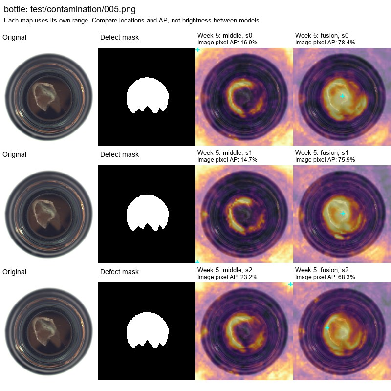
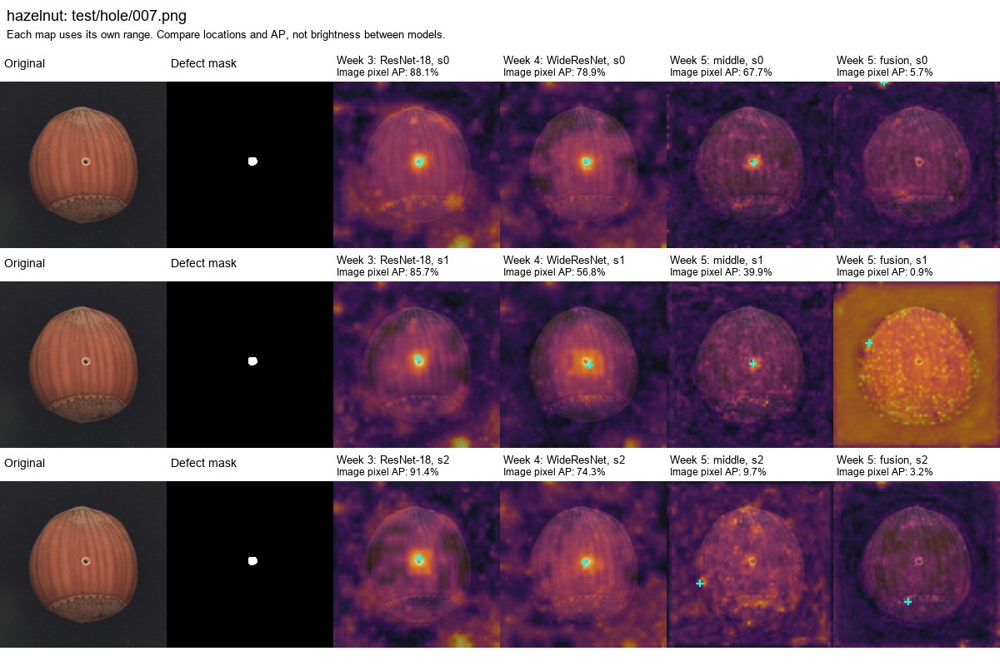

# Week 6: multi-scale results and anomaly maps

[All weeks](../README.md) | [Week 5 implementation](../week5/README.md) | [Heatmap gallery](HEATMAPS.md) | [Cross-week comparison](../comparison/README.md)

Week 6 brings together the results and anomaly maps from the multi-scale experiment developed in Week 5. The comparison covers all 15 MVTec AD categories and three seeds. Fusion improved some categories but reduced the overall scores. These are the same 90 completed runs reported in Week 5; the results are collected here for the Week 6 milestone.

## What we tested

The Week 4 FastFlow configuration processes three backbone levels with separate flows and averages their anomaly maps. This experiment instead combines features before a single flow. We compared that fused representation with a middle-level control to test whether mixing levels helps at a fixed input size.

Both variants use a frozen WideResNet backbone, PCA fitted only on normal training features, a 96-channel input on a 64-by-64 grid, and the same eight-block flow and normalization layer. Each has 1,065,600 trainable parameters. The control uses 96 middle-level PCA components; fusion uses 32 from each of the fine, middle and coarse levels. Paired runs start with the same flow parameters and use the same training order.

The study has **15 categories × 3 seeds × 2 variants = 90 runs**. All results use the fixed 500-epoch endpoint. The [design report](../week5/week5.md) explains the choices and limitations; the [study configuration](../../configs/week5_study.json) records the settings.

## Results

For each seed, we average the scores equally across categories. The table gives the mean and sample standard deviation of those three averages. Pixel AP was the primary metric specified before the full study.

| Metric | Middle-only control | Fusion | Fusion minus control |
| --- | ---: | ---: | ---: |
| Image AUROC | 71.76 ± 3.39% | 67.55 ± 1.66% | -4.21 points |
| Pixel AUROC | 73.89 ± 1.41% | 69.80 ± 1.68% | -4.09 points |
| Pixel AP | 14.57 ± 1.68% | 13.79 ± 1.04% | -0.78 points |

Fusion improved mean pixel AP in six categories and reduced it in nine. All five texture categories declined. Both compact variants also scored below the original Week 4 configuration. Compression, normalization, resizing and the number of flows changed relative to Week 4, so that larger drop cannot be attributed to fusion alone. The paired comparison shows that this particular 96-channel fusion design did not improve the overall result.

The [per-category results](../week5/analysis/per_category.csv), [per-defect results](../week5/analysis/per_defect.csv) and [90-run table](../week5/analysis/per_run.csv) provide the breakdown. The [checkpoint analysis](../week5/checkpoints/README.md) examines late-training behavior while keeping epoch 500 as the reported endpoint.

## Heatmaps and failure examples

The [full Week 6 gallery](HEATMAPS.md) contains 36 sheets: a normal and defective example for every category, plus six previously inspected examples. Each sheet includes both variants and all three seeds. The [cross-week gallery](../comparison/HEATMAPS.md) compares those selected images with Weeks 3 and 4.

Bottle contamination is an example where fusion localizes the annotated defect better than the middle-only control:

Hazelnut hole shows a substantial loss of localization compared with the original configurations:

These examples illustrate gains and failures; the full category results support the overall conclusion. Each heatmap has its own display range, so brightness should not be compared across models. Compare the highlighted locations with the defect mask and the printed pixel AP. The cyan cross marks the highest-scoring pixel. Normal images have no defect mask or per-image AP. Dataset images are credited to [MVTec AD under CC BY-NC-SA 4.0](https://www.mvtec.com/research-teaching/datasets/mvtec-ad).

## Reproducing and checking the results

The [run guide](../../docs/RUNNING.md#week-5) covers the environment, data setup and study commands. Separate [figure-generation commands](../../docs/RUNNING.md#regenerate-figures-or-inspect-saved-models) use the saved predictions. The reports and galleries can be read without downloading models or running training.

The [verification notes](CHECKS.md) record the checks on run coverage, metrics and image files, together with the limits of the audit. They also flag missing files in the local midterm update package; the actual course submission was not checked.
